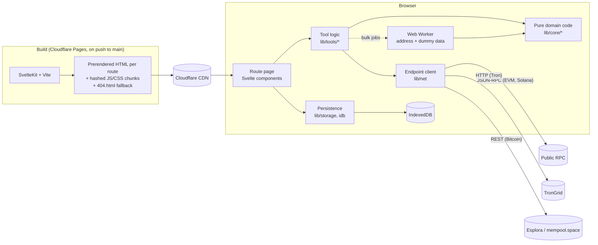
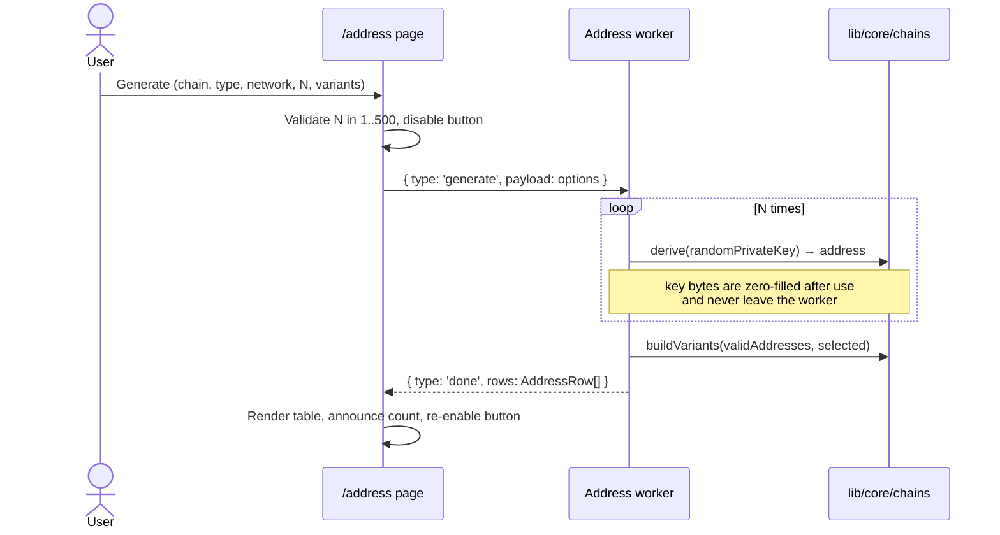
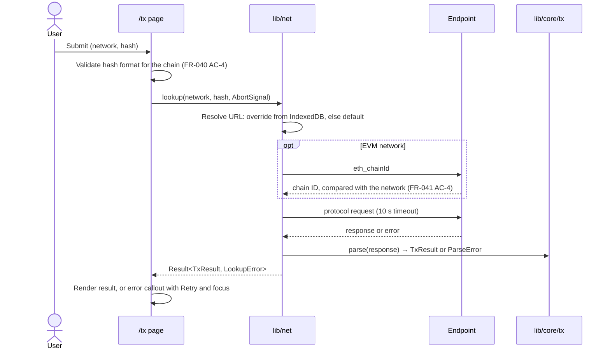

# QAnchor: Architecture

* Status: APPROVED (owner, 2026-11-12)
* Version: 0.1
* Date: 2026-11-12
* Sources: `CLAUDE.md`, `docs/prd.md` v0.3, `docs/design.md` v0.3, `docs/decisions.md`
* Decisions: ADR-001 to ADR-013 in `docs/decisions.md`

Conventions: **[PROPOSAL]** suggested, not yet approved. **[ASSUMPTION]** assumed, to be confirmed. **[VERIFY]** a fact still to be checked. **[LATER]** deliberately not built for the MVP.

## 1. System overview

QAnchor is a static site. Every route is prerendered at build time and hydrated in the browser. There is no server of our own: the only runtime parties are the browser and the public chain endpoints the user calls on purpose.



Rules that follow from this picture:

* `lib/core` imports nothing from Svelte, the DOM, or the network. It is plain TypeScript and is unit-tested directly.
* Only `lib/net` calls `fetch`, and only after a user action (NFR-003, NFR-011).
* Only `lib/storage` touches IndexedDB.
* Workers run `lib/core` code only. They never touch storage or the network.

## 2. Folder structure

```text
qanchor/
├── .github/workflows/ci.yml   # lint, typecheck, unit, build, bundle size, E2E (NFR-020)
├── docs/                      # prd, design, architecture, decisions, plan
├── prototype/                 # static design mockups, not part of the build
├── scripts/
│   └── check-bundle-size.mjs  # gzip budget check for the default route (NFR-001, ADR-009)
├── src/
│   ├── app.html               # document shell + inline theme script (FR-002 AC-1)
│   ├── app.css                # design tokens from docs/design.md + base styles
│   ├── lib/
│   │   ├── core/              # pure domain logic, no Svelte/DOM/network
│   │   │   ├── encoding/      #   base58check, bech32/bech32m wrappers, EIP-55, hex
│   │   │   ├── chains/        #   per-chain address derive + validate + invalid variants
│   │   │   ├── amount/        #   BigInt decimal parse/format, edge-case generator
│   │   │   ├── units/         #   unit families and exact conversion
│   │   │   ├── abi/           #   ABI type parser, decoder, built-in selector table
│   │   │   ├── tx/            #   response parsers per protocol → common TxResult
│   │   │   ├── dummy/         #   seeded PRNG, NIK/NPWP/phone/bank rules, presets
│   │   │   └── result.ts      #   Result<T, E> helper (ADR-013)
│   │   ├── config/
│   │   │   └── networks.ts    #   chains, networks, chain IDs, default endpoints, explorers, faucets
│   │   ├── content/
│   │   │   └── checklists/    #   checklist data (slice 1b)
│   │   ├── data/              #   lazy-loaded datasets: names, regions, banks (slice 1b)
│   │   ├── net/               #   fetch with timeout/abort, error classification (FR-042)
│   │   ├── storage/           #   idb schema, migrations, export/import (FR-003)
│   │   ├── state/             #   app-wide runes: theme, settings (*.svelte.ts)
│   │   ├── workers/           #   worker entry points + typed message protocol
│   │   ├── ui/                #   shared components from docs/design.md section 6
│   │   └── tools/             #   one folder per tool: page sections + tool-local state
│   │       ├── address/
│   │       ├── amounts/
│   │       ├── units/
│   │       └── ...
│   └── routes/
│       ├── +layout.svelte     # app shell (S-00)
│       ├── +layout.ts         # prerender = true, trailingSlash = 'never'
│       ├── +page.svelte       # toolkit index (S-01)
│       ├── address/+page.svelte
│       ├── amounts/+page.svelte
│       ├── units/+page.svelte
│       ├── settings/+page.svelte
│       └── ...                # one folder per tool route (docs/design.md section 3)
├── static/
│   └── _headers               # security headers that a meta CSP cannot set (ADR-007)
├── tests/
│   └── e2e/                   # Playwright specs, one file per tool + cross-cutting specs
└── (config files)             # vite.config.ts (holds the SvelteKit config in v3), playwright.config.ts, eslint, prettier, .nvmrc
```

Why this split (ADR-001): each route imports only its own `lib/tools/<tool>` folder, which imports only the `lib/core` modules it needs, so crypto code and datasets land in route chunks, not in the initial bundle (NFR-015, FR-001 AC-5). Unit tests (`*.test.ts`) sit next to the file they test.

## 3. Data model

### 3.1 Persisted

Generators are stateless (PRD section 8): generated addresses, amounts, and dummy data are never stored.

**Theme preference: `localStorage`**, key `qanchor.theme`, value `'system' | 'light' | 'dark'` (FR-002). Why not IndexedDB: the stored theme must apply before first paint (FR-002 AC-1), and only a synchronous read inside the inline pre-paint script can do that; IndexedDB is asynchronous. If `localStorage` is unavailable, the theme falls back to System for that session. Decided by the owner on 2026-11-12 (plan finding F-1).

**Everything else: IndexedDB**, database `qanchor`, schema version 1.

| Store | Key | Fields | Requirement |
| --- | --- | --- | --- |
| `endpoints` | `networkId` (string, e.g. `eth-sepolia`) | `networkId`, `url: string` (override only; defaults live in code) | FR-041 |
| `wallets` | `id` (string, `crypto.randomUUID()`) | `id`, `label: string`, `chain: ChainId`, `networkId: string`, `address: string`, `notes: string`, `createdAt: number`, `updatedAt: number` | FR-070, FR-071 |
| `faucets` | `id` (string) | `id`, `networkId: string`, `label: string`, `url: string` | FR-072 (user-added links) |

* Index on `wallets` by `[networkId, address]` for the duplicate warning (FR-070 AC-6).
* No store and no field holds a private key or mnemonic (FR-071 AC-2, NFR-012).
* The fetched balance (FR-073) is kept in memory for the session only, with its fetch time; it is not persisted. [PROPOSAL] Why: a stored balance is stale by the next visit, and storing it adds a migration for no user value.
* Migrations: one function per version step in `lib/storage/migrations.ts`, run in `idb`'s `upgrade` callback (NFR-016). A `versionchange` event in another tab triggers a "reload to update" banner (EC-003).

### 3.2 Export file (FR-003)

```json
{
  "app": "qanchor",
  "schemaVersion": 1,
  "exportedAt": "2026-11-12T10:00:00.000Z",
  "data": {
    "settings": { "theme": "system" },
    "endpoints": [],
    "wallets": [],
    "faucets": []
  }
}
```

`settings` comes from `localStorage`; the three arrays come from IndexedDB. Import validates the whole file with hand-written type guards before anything is written (ADR-008), shows counts, and on confirmation clears all stores and writes the file content in one `readwrite` transaction, then writes the theme to `localStorage` only after that transaction commits, so a failure leaves the old data intact (FR-003 AC-3, AC-4, EC-002, EC-020).

### 3.3 Static data (in code, not stored)

| Data | Location | Loaded |
| --- | --- | --- |
| Chains, networks, chain IDs, default endpoints, explorer URL templates, built-in faucets | `lib/config/networks.ts` | Imported by the routes that need it |
| Built-in ABI selectors | `lib/core/abi/selectors.ts` | Calldata route only |
| Checklists | `lib/content/checklists/` | Checklists route only |
| Names, regions, banks, phone prefixes | `lib/data/*.json` | Dynamic `import()` from the dummy-data worker |

### 3.4 Core types (sketch)

```ts
type ChainId = 'evm' | 'bitcoin' | 'solana' | 'tron';
type Validity = 'valid' | 'invalid' | 'risky';

interface AddressRow {
  address: string;
  chain: ChainId;
  type: string;        // e.g. 'p2tr', 'standard'
  network: string;     // 'mainnet' | 'testnet' | 'any'
  validity: Validity;
  variantId: string;   // stable ID, e.g. 'evm.wrong-checksum'
  reason: string;
  sourceChain?: ChainId; // look-alike variants only (FR-011 AC-3)
}

interface TxResult {
  status: 'success' | 'failed' | 'pending';
  block: string | null;   // block number or slot; null while pending
  from: string | null;    // null for Bitcoin, which has inputs instead
  to: string | null;
  valueBase: bigint;      // smallest unit
  fee: bigint | null;     // null while pending (FR-040 AC-3)
  extra: EvmExtra | BitcoinExtra | SolanaExtra | TronExtra;
}
```

## 4. Data flows

### 4.1 Generate addresses (FR-010, FR-011, NFR-005, NFR-012)



* Keys come from `crypto.getRandomValues` through noble's `randomPrivateKey` (NFR-013).
* The worker message contains addresses only. Private key bytes never cross `postMessage`, so they cannot reach the DOM, storage, or the network (NFR-012).
* For N below a small threshold the same `lib/core` function may run on the main thread [PROPOSAL]; the threshold is set by measurement, not guessed.

### 4.2 Look up a transaction (FR-040 to FR-043)



* `LookupError.code` is one of `not-found`, `rate-limited`, `network`, `timeout`, `bad-response`, `chain-mismatch`, each mapped to the copy in `docs/design.md` section 7 (FR-042).
* The page owns an `AbortController`; unmounting aborts the request (FR-040 AC-5, NFR-019).

## 5. Default endpoints

Verified on 2026-11-12 with a CORS preflight and a real request carrying `Origin: https://qanchor.pages.dev`, from one network. Public endpoints change without notice, so this table is re-checked before each slice that depends on it, and users can always override (FR-041).

| Network | Protocol | Default URL | Check result |
| --- | --- | --- | --- |
| Ethereum | JSON-RPC | `https://ethereum-rpc.publicnode.com` | CORS ok, chain ID `0x1` |
| Ethereum Sepolia | JSON-RPC | `https://ethereum-sepolia-rpc.publicnode.com` | CORS ok, `0xaa36a7` |
| BNB Smart Chain | JSON-RPC | `https://bsc-dataseed.bnbchain.org` | CORS ok, `0x38` |
| BSC Testnet | JSON-RPC | `https://data-seed-prebsc-1-s1.bnbchain.org:8545` | CORS ok, `0x61` |
| Polygon | JSON-RPC | `https://polygon-bor-rpc.publicnode.com` | CORS ok, `0x89` |
| Polygon Amoy | JSON-RPC | `https://polygon-amoy-bor-rpc.publicnode.com` | CORS ok, `0x13882` |
| Arbitrum One | JSON-RPC | `https://arb1.arbitrum.io/rpc` | CORS ok, `0xa4b1` |
| Arbitrum Sepolia | JSON-RPC | `https://sepolia-rollup.arbitrum.io/rpc` | CORS ok, `0x66eee` |
| Base | JSON-RPC | `https://mainnet.base.org` | CORS ok (origin echoed), `0x2105` |
| Base Sepolia | JSON-RPC | `https://sepolia.base.org` | CORS ok (origin echoed), `0x14a34` |
| Solana | JSON-RPC | `https://solana-rpc.publicnode.com` | CORS ok, `getSlot` answered |
| Solana Devnet | JSON-RPC | `https://api.devnet.solana.com` | CORS ok, `getHealth` = ok |
| Tron | HTTP API | `https://api.trongrid.io` | CORS ok, `/wallet/getnowblock` answered |
| Tron Nile | HTTP API | `https://nile.trongrid.io` | CORS ok, `/wallet/getnowblock` answered |
| Bitcoin | Esplora REST | `https://mempool.space/api` | **[VERIFY]** not reachable from the network used for the check |
| Bitcoin Testnet4 | Esplora REST | `https://mempool.space/testnet4/api` | **[VERIFY]** same |

Rejected during the check: `polygon-rpc.com` (HTTP 401, "tenant disabled"), `rpc-amoy.polygon.technology` (no response), `api.mainnet-beta.solana.com` (HTTP 403 "Access forbidden" for `getSlot` and `getHealth` from the test network).

Testnet choices: Sepolia for Ethereum, Arbitrum, and Base; Amoy for Polygon; Devnet for Solana; Nile for Tron; Testnet4 for Bitcoin [PROPOSAL] (one testnet per chain, PRD decision OQ-29).

Explorer URL templates (FR-043) and built-in faucet links (FR-072) are written into `networks.ts` in slice 1c and checked by hand then. [VERIFY]

## 6. Conventions

### Naming

* Files: `kebab-case.ts`; Svelte components: `PascalCase.svelte`; runes modules: `*.svelte.ts`.
* Variant IDs: `<chain>.<variant>` in kebab case (`evm.wrong-checksum`, `btc.bech32m-mixup`). They appear in exports (FR-012), so once shipped they never change.
* Network IDs: `<chain>-<network>` (`eth-mainnet`, `sol-devnet`).

### Error handling (ADR-013)

* Expected failures (invalid input, endpoint errors, decode errors) are values: `lib/core` and `lib/net` return `Result<T, E>` with a typed `code`. They do not throw.
* Unexpected failures (bugs) throw and reach a single error boundary in the layout that shows "Something went wrong" with a reload action.
* Every `code` maps to user copy in one place per tool, so the strings in `docs/design.md` section 7 have one source.

### Logging

* No logging in production code paths, no telemetry (NFR-011). `console.error` only in the global error boundary.
* Never log or display key material (NFR-012). ESLint bans `console.log` (`no-console` with `error` allowed).

### Configuration

* No secrets and no `.env` files: the app has nothing secret to configure.
* The only build-time value is the commit ID, read from Cloudflare's `CF_PAGES_COMMIT_SHA` and injected with Vite `define`; local builds show `dev` (NFR-021).
* Runtime configuration is user data: endpoint overrides and faucet links in IndexedDB.

### Browser-only code

* Code that uses IndexedDB, Web Crypto, the clipboard, or workers runs only in `onMount` or behind `browser` from `$app/env` (renamed from `$app/environment` in SvelteKit 3), so prerendering never executes it (NFR-022).
* Pages that read storage render a loading state in their static HTML (FR-003 AC-5, EC-026).

## 7. Testing strategy

| Level | Tool | What | Examples |
| --- | --- | --- | --- |
| Unit | Vitest | All of `lib/core`, `lib/net` error classification (with a stubbed `fetch`), `lib/storage` import validation and migrations | EIP-55, BIP-173, BIP-350, Base58Check, ABI test vectors (NFR-014); every invalid variant fails its validator (FR-011 AC-2); BigInt boundaries at 78 digits; seeded determinism byte for byte (FR-082) |
| E2E | Playwright (Chromium, Firefox, WebKit) | User journeys and cross-cutting rules on the built site (`vite preview`) | Generate, copy, export per tool; keyboard-only paths (NFR-008); theme without flash (FR-002); reduced motion (NFR-006); no requests after 10 s idle (NFR-003); request allowlist (NFR-011); DOM, IndexedDB, and requests contain no key material (NFR-012) |
| Accessibility | `@axe-core/playwright` inside E2E | WCAG 2.1 AA scan of every route in both themes (NFR-009) | One scan per route per theme |
| Build checks | svelte-check, ESLint, Prettier, `check-bundle-size.mjs` | Types, lint, format, initial JS ≤ 80 KB gzip | Runs in CI on every PR (NFR-020) |
| On the live site | Lighthouse, Chrome DevTools | NFR-002, NFR-004, CSP header check (NFR-017) | After each production deploy, by hand |

* Network in E2E: chain endpoints are stubbed with Playwright `route()` fixtures, so tests are deterministic and never hit public RPCs. The real endpoints are covered by the manual check in section 5.
* No component-test layer [PROPOSAL]: logic lives in `lib/core` (unit-tested) and behaviour is covered by E2E, so a third layer would add tooling without catching a different class of bug.

## 8. Dependencies

| Package | Kind | Why | Size impact |
| --- | --- | --- | --- |
| `@noble/curves` | runtime | secp256k1 (EVM, Bitcoin, Tron keys), schnorr (Taproot), ed25519 (Solana) | Route chunks only; measured when the address tool is built |
| `@noble/hashes` | runtime | keccak-256, sha256, ripemd160, tagged hashes | Same |
| `@scure/base` | runtime | base58, base58check, bech32, bech32m, hex | Same |
| `idb` | runtime | Promise wrapper for IndexedDB | Small (not measured); loaded only by routes that persist data |
| `@fontsource-variable/inter` | runtime (font file only) | Self-hosted Inter, Latin subset (ADR-010) | No JS; woff2 size **[VERIFY]** measured in slice 1a against LCP |
| `@sveltejs/kit`, `svelte`, `vite`, `@sveltejs/adapter-static` | build | Framework (kickoff decision) | Svelte runtime is part of the 80 KB budget |
| `typescript`, `svelte-check`, `eslint` + Svelte/TS plugins, `prettier` + Svelte plugin | dev | Typecheck, lint, format | None at runtime |
| `vitest`, `@playwright/test`, `@axe-core/playwright` | dev | Unit, E2E, accessibility scan | None at runtime |

Not used, on purpose: ethers, @solana/web3.js, faker, Comlink, zod, big.js, size-limit, Tailwind, icon libraries (ADR-003 to ADR-009, kickoff decisions). `@scure/btc-signer` is not needed: Bitcoin addresses are built from `@noble/*` and `@scure/base` directly.

Tooling defaults: npm as the package manager and Node 26 LTS pinned in `.nvmrc` [ASSUMPTION]. Node 26 is the version installed locally; whether it is already in Active LTS and supported by `actions/setup-node` is checked when CI is set up.

## 9. Technical risks

| Risk | Impact | Mitigation |
| --- | --- | --- |
| Public endpoints change, rate-limit, or drop CORS | Tx lookup and balance fail for users | Clear error states (FR-042), per-network override (FR-041), endpoint table re-checked per slice, E2E uses stubs so CI is not flaky |
| Bitcoin endpoints unverified from the test network | Slice 1c Bitcoin lookup may need another default | Re-check from another network before slice 1c; fallback candidates are other Esplora instances |
| Own ABI decoder gets dynamic offsets or nested tuples wrong | Wrong decoded values shown as valid | Published ABI test vectors, malformed-input tests for FR-052 AC-4; decoder ships in 1c, after the first deploy |
| Taproot tweak (BIP-341) implemented by hand on top of noble | Invalid P2TR addresses marked valid | BIP-341 and BIP-350 vectors; generated addresses round-trip through the validator (FR-010 AC-2) |
| Inline theme script blocked by the CSP | Theme flash or broken theme | Resolved in T-004: `vite.config.ts` hashes the `app.html` script into `script-src`, the script sits after the CSP meta tag, and E2E fails on any CSP violation (`docs/decisions.md`, CSP spike results) |
| Initial bundle exceeds 80 KB gzip | NFR-001 fails | Budget check in CI from the first PR; crypto and datasets only in route chunks |
| `*.pages.dev` and the `qanchor` project name unverified from the test network | First deploy URL may differ | Checked when the Cloudflare project is created at the end of slice 1a |
| Cloudflare 404 status code for `404.html` not documented | A not-found page might answer HTTP 200 | Checked on the first preview deploy; the user-facing behaviour (not-found state) is the same either way |
| IndexedDB unavailable (private mode) | Saving fails | Storage layer reports unavailability once; banner shown; tools still work (EC-001) |

## 10. Routing and hosting details

* Every route sets `prerender = true` and `trailingSlash = 'never'`, so `/address` is served from `address.html` (Cloudflare serves a matching HTML file for the route and redirects `/address.html` to `/address`).
* adapter-static writes `404.html` as a client-rendered fallback. Cloudflare Pages serves the nearest `404.html` for paths that match no file; with a top-level `404.html` present, it does not switch to SPA mode (Cloudflare Pages docs, "Serving Pages", read 2026-11-12). The fallback renders the not-found state (FR-001 AC-3, NFR-022).
* Phase 2 pages for user-created records use query-string IDs on prerendered routes (`/runs?id=…`) [PROPOSAL, LATER], which avoids per-record routes entirely.
* Cloudflare Web Analytics stays disabled in the Pages project settings (NFR-011).
