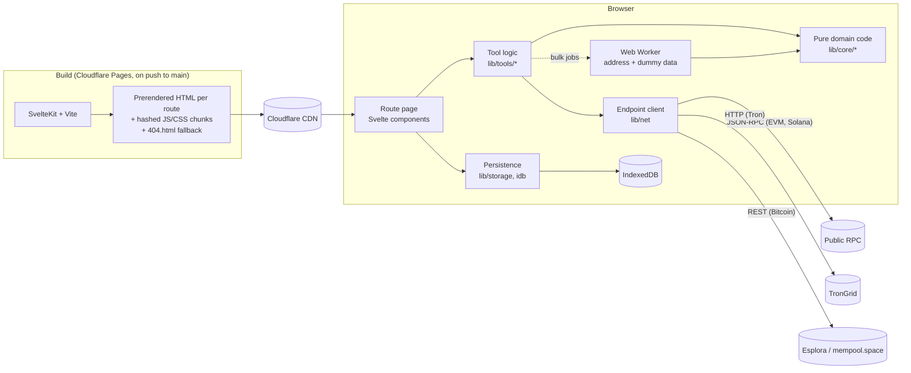
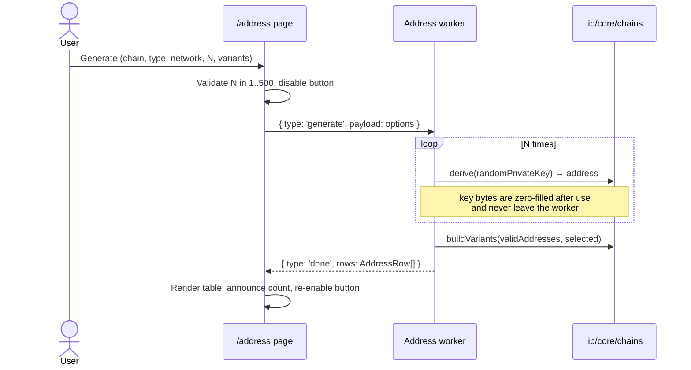
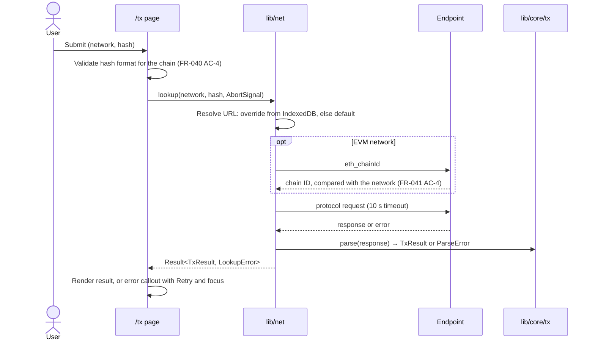

# QAnchor: Architecture

* Status: APPROVED (owner, 2026-11-12); v0.2 additions for slice 2a approved on 2026-11-19, marked "v0.2"
* Version: 0.2
* Date: 2026-11-12
* Sources: `CLAUDE.md`, `docs/prd.md` v0.3, `docs/design.md` v0.3, `docs/decisions.md`
* Decisions: ADR-001 to ADR-015 in `docs/decisions.md` (ADR-015 with the slice 2a plan)

Conventions: **[PROPOSAL]** suggested, not yet approved. **[ASSUMPTION]** assumed, to be confirmed. **[VERIFY]** a fact still to be checked. **[LATER]** deliberately not built for the MVP.

## 1. System overview

QAnchor is a static site. Every route is prerendered at build time and hydrated in the browser. There is no server of our own: the only runtime parties are the browser and the public chain endpoints the user calls on purpose.



Rules that follow from this picture:

* `lib/core` imports nothing from Svelte, the DOM, or the network. It is plain TypeScript and is unit-tested directly.
* Only `lib/net` calls `fetch`, and only after a user action (NFR-003, NFR-011).
* Only `lib/storage` touches IndexedDB.
* Workers run `lib/core` code only. They never touch storage or the network.

## 2. Folder structure

```text
qanchor/
├── .github/workflows/ci.yml   # lint, typecheck, unit, build, bundle size, E2E (NFR-020)
├── docs/                      # prd, design, architecture, decisions, plan
├── prototype/                 # static design mockups, not part of the build
├── scripts/
│   └── check-bundle-size.mjs  # gzip budget check for the default route (NFR-001, ADR-009)
├── src/
│   ├── app.html               # document shell + inline theme script (FR-002 AC-1)
│   ├── app.css                # design tokens from docs/design.md + base styles
│   ├── lib/
│   │   ├── core/              # pure domain logic, no Svelte/DOM/network
│   │   │   ├── encoding/      #   base58check, bech32/bech32m wrappers, EIP-55, hex
│   │   │   ├── chains/        #   per-chain address derive + validate + invalid variants
│   │   │   ├── amount/        #   BigInt decimal parse/format, edge-case generator
│   │   │   ├── units/         #   unit families and exact conversion
│   │   │   ├── abi/           #   ABI type parser, decoder, built-in selector table
│   │   │   ├── tx/            #   response parsers per protocol → common TxResult
│   │   │   ├── dummy/         #   seeded PRNG, NIK/NPWP/phone/bank rules, presets
│   │   │   ├── export/        #   CSV (RFC 4180) and JSON writers for output actions (FR-004, FR-083)
│   │   │   ├── qa/            #   test cases, runs, results: limits, filters, snapshots, summaries (v0.2)
│   │   │   └── result.ts      #   Result<T, E> helper (ADR-013)
│   │   ├── config/
│   │   │   └── networks.ts    #   chains, networks, chain IDs, default endpoints, explorers, faucets
│   │   ├── content/
│   │   │   └── checklists/    #   checklist data (slice 1b)
│   │   ├── data/              #   lazy-loaded datasets: names, regions, banks (slice 1b)
│   │   ├── net/               #   fetch with timeout/abort, error classification (FR-042)
│   │   ├── storage/           #   idb schema, migrations, export/import (FR-003)
│   │   ├── state/             #   app-wide runes: theme, settings (*.svelte.ts)
│   │   ├── workers/           #   worker entry points + typed message protocol
│   │   ├── ui/                #   shared components from docs/design.md section 6
│   │   └── tools/             #   one folder per tool: page sections + tool-local state
│   │       ├── address/
│   │       ├── amounts/
│   │       ├── units/
│   │       └── ...
│   └── routes/
│       ├── +layout.svelte     # app shell (S-00)
│       ├── +layout.ts         # prerender = true, trailingSlash = 'never'
│       ├── +page.svelte       # toolkit index (S-01)
│       ├── address/+page.svelte
│       ├── amounts/+page.svelte
│       ├── units/+page.svelte
│       ├── settings/+page.svelte
│       ├── cases/             # +page (list), new/, edit/ (?id=) (v0.2)
│       ├── runs/              # +page (list), new/, view/ (?id=&case=) (v0.2)
│       └── ...                # one folder per tool route (docs/design.md section 3)
├── static/
│   └── _headers               # security headers that a meta CSP cannot set (ADR-007)
├── tests/
│   └── e2e/                   # Playwright specs, one file per tool + cross-cutting specs
└── (config files)             # vite.config.ts (holds the SvelteKit config in v3), playwright.config.ts, eslint, prettier, .nvmrc
```

Why this split (ADR-001): each route imports only its own `lib/tools/<tool>` folder, which imports only the `lib/core` modules it needs, so crypto code and datasets land in route chunks, not in the initial bundle (NFR-015, FR-001 AC-5). Unit tests (`*.test.ts`) sit next to the file they test.

## 3. Data model

### 3.1 Persisted

Generators are stateless (PRD section 8): generated addresses, amounts, and dummy data are never stored.

**Theme preference: `localStorage`**, key `qanchor.theme`, value `'system' | 'light' | 'dark'` (FR-002). Why not IndexedDB: the stored theme must apply before first paint (FR-002 AC-1), and only a synchronous read inside the inline pre-paint script can do that; IndexedDB is asynchronous. If `localStorage` is unavailable, the theme falls back to System for that session. Decided by the owner on 2026-11-12 (plan finding F-1).

**Everything else: IndexedDB**, database `qanchor`, schema version 1.

| Store | Key | Fields | Requirement |
| --- | --- | --- | --- |
| `endpoints` | `networkId` (string, e.g. `eth-sepolia`) | `networkId`, `url: string` (override only; defaults live in code) | FR-041 |
| `wallets` | `id` (string, `crypto.randomUUID()`) | `id`, `label: string`, `chain: ChainId`, `networkId: string`, `address: string`, `notes: string`, `createdAt: number`, `updatedAt: number` | FR-070, FR-071 |
| `faucets` | `id` (string) | `id`, `networkId: string`, `label: string`, `url: string` | FR-072 (user-added links) |

* Index on `wallets` by `[networkId, address]` for the duplicate warning (FR-070 AC-6).
* No store and no field holds a private key or mnemonic (FR-071 AC-2, NFR-012).
* The fetched balance (FR-073) is kept in memory for the session only, with its fetch time; it is not persisted. [PROPOSAL] Why: a stored balance is stale by the next visit, and storing it adds a migration for no user value.
* Migrations: one function per version step in `lib/storage/migrations.ts`, run in `idb`'s `upgrade` callback (NFR-016). A `versionchange` event in another tab triggers a "reload to update" banner (EC-003).

**Schema version 2 (v0.2, slice 2a, ADR-015).** Migration 2 adds four stores and changes none of the v1 stores.

| Store | Key | Fields | Requirement |
| --- | --- | --- | --- |
| `testCases` | `id` (string, `crypto.randomUUID()`) | `id`, `number: number` (shown as `TC-<number>`), `title`, `preconditions`, `steps: { action: string; expected: string }[]`, `expected`, `tags: string[]`, `priority: 'critical' \| 'high' \| 'medium' \| 'low'`, `createdAt`, `updatedAt` | FR-100 to FR-102 |
| `runs` | `id` (string) | `id`, `name`, `release`, `environment`, `status: 'in-progress' \| 'completed'`, `cases: CaseSnapshot[]` (copy of each case at creation, in key order), `createdAt`, `updatedAt`, `completedAt: number \| null` | FR-110, FR-113 |
| `results` | `[runId, caseNumber]` | `runId`, `caseNumber`, `status: 'pass' \| 'fail' \| 'blocked'`, `failedStep: number \| null` (0 = not step-specific), `actual`, `reason`, `notes`, `linkedIssue`, `updatedAt` | FR-111, FR-123 |
| `meta` | `key` (string) | `key: 'caseCounter'`, `value: number` (highest key number ever assigned) | FR-100 AC-2 |

* Unique index on `testCases.number`; index on `results.runId` for reading a run and for the cascade delete.
* An untested case has no result record. A run's progress is computed from its results, never stored.
* A new case reads and raises `caseCounter` and writes the case in one transaction, so two tabs cannot assign the same key.
* Deleting a run deletes its results in the same transaction (NFR-024). Deleting a test case touches no run (FR-110 AC-3).
* Slice 2b adds schema version 3 with a `screenshots` store (finding F-6).

### 3.2 Export file (FR-003)

```json
{
  "app": "qanchor",
  "schemaVersion": 1,
  "exportedAt": "2026-11-12T10:00:00.000Z",
  "data": {
    "settings": { "theme": "system" },
    "endpoints": [],
    "wallets": [],
    "faucets": []
  }
}
```

From schema version 2 (v0.2), `data` also carries `testCases`, `runs`, and `results`. `meta` is not exported: on import the counter is rebuilt as the highest case number found in `testCases` and in every run's snapshots (plan finding F-5). A version 1 file is still accepted; it is upgraded in memory to version 2 with empty Phase 2 arrays before the guards run (FR-091 AC-3).

`settings` comes from `localStorage`; the three arrays come from IndexedDB. Import validates the whole file with hand-written type guards before anything is written (ADR-008), shows counts, and on confirmation clears all stores and writes the file content in one `readwrite` transaction, then writes the theme to `localStorage` only after that transaction commits, so a failure leaves the old data intact (FR-003 AC-3, AC-4, EC-002, EC-020).

### 3.3 Static data (in code, not stored)

| Data | Location | Loaded |
| --- | --- | --- |
| Chains, networks, chain IDs, default endpoints, explorer URL templates, built-in faucets | `lib/config/networks.ts` | Imported by the routes that need it |
| Built-in ABI selectors | `lib/core/abi/selectors.ts` | Calldata route only |
| Checklists | `lib/content/checklists/` | Checklists route only |
| Names, regions, banks, phone prefixes | `lib/data/*.json` | Dynamic `import()` from the dummy-data worker |

### 3.4 Core types (sketch)

```ts
type ChainId = 'evm' | 'bitcoin' | 'solana' | 'tron';
type Validity = 'valid' | 'invalid' | 'risky';

interface AddressRow {
  address: string;
  chain: ChainId;
  type: string;        // e.g. 'p2tr', 'standard'
  network: string;     // 'mainnet' | 'testnet' | 'any'
  validity: Validity;
  variantId: string;   // stable ID, e.g. 'evm.wrong-checksum'
  reason: string;
  sourceChain?: ChainId; // look-alike variants only (FR-011 AC-3)
}

interface TxResult {
  status: 'success' | 'failed' | 'pending';
  block: string | null;   // block number or slot; null while pending
  from: string | null;    // null for Bitcoin, which has inputs instead
  to: string | null;
  valueBase: bigint | null; // smallest unit; null when not known yet (Solana pending)
  fee: bigint | null;     // null while not known (pending EVM or Solana; FR-040 AC-3)
  extra: EvmExtra | BitcoinExtra | SolanaExtra | TronExtra;
}
```

Phase 2 (v0.2):

```ts
type CaseSnapshot = Pick<TestCase, 'id' | 'number' | 'title' | 'preconditions' | 'steps' | 'expected' | 'tags' | 'priority'>;
type ResultStatus = 'pass' | 'fail' | 'blocked'; // 'untested' = no result record
```

## 4. Data flows

### 4.1 Generate addresses (FR-010, FR-011, NFR-005, NFR-012)



* Keys come from `crypto.getRandomValues` through noble's `randomPrivateKey` (NFR-013).
* The worker message contains addresses only. Private key bytes never cross `postMessage`, so they cannot reach the DOM, storage, or the network (NFR-012).
* For N below a small threshold the same `lib/core` function may run on the main thread [PROPOSAL]; the threshold is set by measurement, not guessed.

### 4.2 Look up a transaction (FR-040 to FR-043)



* `LookupError.code` is one of `not-found`, `rate-limited`, `network`, `timeout`, `bad-response`, `chain-mismatch`, each mapped to the copy in `docs/design.md` section 7 (FR-042). A seventh code, `aborted`, means the caller cancelled (a newer lookup, or the page was left); it is never shown (T-036).
* The page owns an `AbortController`; unmounting aborts the request (FR-040 AC-5, NFR-019).

## 5. Default endpoints

Re-checked on 2026-11-17 (T-035) in real browsers, Chromium and Firefox, with `fetch()` from a page on `https://qanchor.pages.dev`, so each browser applied its own CORS rules for the production origin. Each endpoint was asked for its chain ID where it has one, a recent transaction with its receipt or status, an old transaction (from the block at half the current height), and an unknown hash. The unknown hash has to come back as "not found" (`null` or HTTP 404), not as an error. All calls were reads; no transaction was sent. The first check, on 2026-11-12, only proved CORS and a chain ID. Public endpoints change without notice, so this table is re-checked before each slice that depends on it, and users can always override (FR-041).

| Network | Protocol | Default URL | Check result (2026-11-17) |
| --- | --- | --- | --- |
| Ethereum | JSON-RPC | `https://mainnet.gateway.tenderly.co` | `0x1`; recent and old tx ok; unknown → `null` |
| Ethereum Sepolia | JSON-RPC | `https://sepolia.gateway.tenderly.co` | `0xaa36a7`; recent and old ok; unknown → `null` |
| BNB Smart Chain | JSON-RPC | `https://bsc-dataseed.bnbchain.org` | `0x38`; recent and old ok; unknown → `null` |
| BSC Testnet | JSON-RPC | `https://data-seed-prebsc-1-s1.bnbchain.org:8545` | `0x61`; recent and old ok; unknown → `null` |
| Polygon | JSON-RPC | `https://polygon.gateway.tenderly.co` | `0x89`; recent and old ok; unknown → `null` |
| Polygon Amoy | JSON-RPC | `https://polygon-amoy.gateway.tenderly.co` | `0x13882`; recent and old ok; unknown → `null` |
| Arbitrum One | JSON-RPC | `https://arb1.arbitrum.io/rpc` | `0xa4b1`; recent and old ok; unknown → `null` |
| Arbitrum Sepolia | JSON-RPC | `https://sepolia-rollup.arbitrum.io/rpc` | `0x66eee`; recent and old ok; unknown → `null` |
| Base | JSON-RPC | `https://mainnet.base.org` | `0x2105`; recent and old ok; unknown → `null` |
| Base Sepolia | JSON-RPC | `https://base-sepolia.gateway.tenderly.co` | `0x14a34`; recent and old ok; unknown → `null` |
| Solana | JSON-RPC | `https://solana-rpc.publicnode.com` | `getTransaction` ok; unknown → `null`; **keeps only about the last 2 to 3 days** (`getFirstAvailableBlock`), see below |
| Solana Devnet | JSON-RPC | `https://api.devnet.solana.com` | `getTransaction` ok for recent, 30-day-old, and old; unknown → `null` |
| Tron | HTTP API | `https://api.trongrid.io` | `/wallet/gettransactionbyid` and `/wallet/gettransactioninfobyid` ok |
| Tron Nile | HTTP API | `https://nile.trongrid.io` | same calls ok |
| Bitcoin | Esplora REST | `https://mempool.space/api` | `/tx/:txid` and `/tx/:txid/status` ok for recent and old; unknown → HTTP 404 |
| Bitcoin Testnet4 | Esplora REST | `https://mempool.space/testnet4/api` | same |

Replaced on 2026-11-17 (they answered, but would have shown a real transaction as "not found"):

* `ethereum-rpc.publicnode.com`, `ethereum-sepolia-rpc.publicnode.com`, `polygon-amoy-bor-rpc.publicnode.com`: return `null` for a transaction older than their retention window.
* `polygon-bor-rpc.publicnode.com`: answers any hash it does not hold, unknown or old, with HTTP 403 "Archive requests require a personal token".
* `sepolia.base.org`: "pruned history unavailable" for old blocks.

Tenderly's gateways are public and need no key ("without one, requests go to the public Tenderly RPC endpoint, which carries public endpoint limits", docs.tenderly.co, Node RPC reference). Five networks now depend on one provider; each can be overridden in Settings.

Also tried and rejected (from this network, in a browser): `eth.llamarpc.com`, `eth.merkle.io`, `polygon.llamarpc.com`, `polygon-mainnet.public.blastapi.io`, `rpc.sepolia.org`, `rpc-amoy.polygon.technology` (failed to fetch); `rpc.flashbots.net` (pruned); `1rpc.io/matic`, `polygon-amoy.drpc.org` (old tx `null`); `1rpc.io/sepolia` (HTTP 429); `sepolia.drpc.org`, `solana.drpc.org` (paid plan only); `polygon-rpc.com` (HTTP 401); `api.mainnet-beta.solana.com` (HTTP 403). Passed but not chosen: `eth.drpc.org`, `eth-mainnet.public.blastapi.io`, `rpc.mevblocker.io`, `polygon.drpc.org`.

Solana mainnet: no keyless endpoint with full history passed. The default stays, and a "not found" on Solana mainnet adds that the default endpoint keeps only recent days and suggests an override with full history (`docs/design.md` section 7).

Bitcoin: mempool.space timed out from the test network in the first runs of the day and answered later, from the same network, in both browsers. `blockstream.info/api` (also `/testnet4/api`) passed the same checks and is the documented alternative; on the test network its name is blocked by the ISP's DNS filter, so it was reached by IP. Either can fail on a filtered network, which FR-042 AC-3 reports as a connection error, not as "not found".

Testnet choices: Sepolia for Ethereum, Arbitrum, and Base; Amoy for Polygon; Devnet for Solana; Nile for Tron; Testnet4 for Bitcoin (one testnet per chain, PRD decision OQ-29).

### 5.1 Explorer URL templates (FR-043)

Checked 2026-11-17 by opening each template with a transaction from the check above in Chromium: the page showed the hash. `{hash}` is the transaction hash or signature as entered.

| Network | Template | Check |
| --- | --- | --- |
| Ethereum | `https://etherscan.io/tx/{hash}` | ok |
| Ethereum Sepolia | `https://sepolia.etherscan.io/tx/{hash}` | ok |
| BNB Smart Chain | `https://bscscan.com/tx/{hash}` | bot check in automation; owner to open by hand |
| BSC Testnet | `https://testnet.bscscan.com/tx/{hash}` | bot check; owner to open by hand |
| Polygon | `https://polygonscan.com/tx/{hash}` | ok |
| Polygon Amoy | `https://amoy.polygonscan.com/tx/{hash}` | ok |
| Arbitrum One | `https://arbiscan.io/tx/{hash}` | ok |
| Arbitrum Sepolia | `https://sepolia.arbiscan.io/tx/{hash}` | ok |
| Base | `https://basescan.org/tx/{hash}` | ok |
| Base Sepolia | `https://sepolia.basescan.org/tx/{hash}` | bot check; owner to open by hand |
| Solana | `https://explorer.solana.com/tx/{hash}` | ok |
| Solana Devnet | `https://explorer.solana.com/tx/{hash}?cluster=devnet` | ok |
| Tron | `https://tronscan.org/#/transaction/{hash}` | bot check; owner to open by hand |
| Tron Nile | `https://nile.tronscan.org/#/transaction/{hash}` | ok |
| Bitcoin | `https://mempool.space/tx/{hash}` | ok |
| Bitcoin Testnet4 | `https://mempool.space/testnet4/tx/{hash}` | ok |

The bot-check pages are the same explorer families as passing ones (Etherscan's `/tx/`, Tronscan's `#/transaction/`), so the templates are expected to work [ASSUMPTION]; QAnchor does not try to get past a bot check.

### 5.2 Built-in faucet links (FR-072)

Checked 2026-11-17: each page loaded in Chromium and is a faucet for that network. Sources: the chains' own docs where they list faucets (Base, Arbitrum, Tron, the Bitcoin Wiki for Testnet4).

| Network | Faucets |
| --- | --- |
| Ethereum Sepolia | `https://cloud.google.com/application/web3/faucet/ethereum/sepolia`, `https://faucets.chain.link/sepolia`, `https://www.alchemy.com/faucets/ethereum-sepolia` |
| BSC Testnet | `https://www.bnbchain.org/en/testnet-faucet` |
| Polygon Amoy | `https://faucet.polygon.technology/` (bot check in automation; owner to open by hand) |
| Arbitrum Sepolia | `https://arbitrum.faucet.dev/`, `https://faucets.chain.link/arbitrum-sepolia`, `https://www.alchemy.com/faucets/arbitrum-sepolia` |
| Base Sepolia | `https://www.alchemy.com/faucets/base-sepolia`, `https://portal.cdp.coinbase.com/onchain-tools/faucet` (connection refused from the test network; owner to open by hand) |
| Solana Devnet | `https://faucet.solana.com/` |
| Tron Nile | `https://nileex.io/join/getJoinPage` |
| Bitcoin Testnet4 | `https://mempool.space/testnet4/faucet`, `https://coinfaucet.eu/en/btc-testnet4/` |

Rejected: `faucet.testnet4.dev` (listed on the Bitcoin Wiki; the domain is now for sale). Mainnets have no faucet; the tracker shows "no faucet listed" (FR-072 AC-3).

## 6. Conventions

### Naming

* Files: `kebab-case.ts`; Svelte components: `PascalCase.svelte`; runes modules: `*.svelte.ts`.
* Variant IDs: `<chain>.<variant>` in kebab case (`evm.wrong-checksum`, `btc.bech32m-mixup`). They appear in exports (FR-012), so once shipped they never change.
* Network IDs: `<chain>-<network>` (`eth-mainnet`, `sol-devnet`).

### Error handling (ADR-013)

* Expected failures (invalid input, endpoint errors, decode errors) are values: `lib/core` and `lib/net` return `Result<T, E>` with a typed `code`. They do not throw.
* Unexpected failures (bugs) throw and reach a single error boundary in the layout that shows "Something went wrong" with a reload action.
* Every `code` maps to user copy in one place per tool, so the strings in `docs/design.md` section 7 have one source.

### Logging

* No logging in production code paths, no telemetry (NFR-011). `console.error` only in the global error boundary.
* Never log or display key material (NFR-012). ESLint bans `console.log` (`no-console` with `error` allowed).

### Configuration

* No secrets and no `.env` files: the app has nothing secret to configure.
* The only build-time value is the commit ID, read from Cloudflare's `CF_PAGES_COMMIT_SHA` and injected with Vite `define`; local builds show `dev` (NFR-021).
* Runtime configuration is user data: endpoint overrides and faucet links in IndexedDB.

### Browser-only code

* Code that uses IndexedDB, Web Crypto, the clipboard, or workers runs only in `onMount` or behind `browser` from `$app/env` (renamed from `$app/environment` in SvelteKit 3), so prerendering never executes it (NFR-022).
* Pages that read storage render a loading state in their static HTML (FR-003 AC-5, EC-026).

## 7. Testing strategy

| Level | Tool | What | Examples |
| --- | --- | --- | --- |
| Unit | Vitest | All of `lib/core`, `lib/net` error classification (with a stubbed `fetch`), `lib/storage` import validation and migrations | EIP-55, BIP-173, BIP-350, Base58Check, ABI test vectors (NFR-014); every invalid variant fails its validator (FR-011 AC-2); BigInt boundaries at 78 digits; seeded determinism byte for byte (FR-082) |
| E2E | Playwright (Chromium, Firefox, WebKit) | User journeys and cross-cutting rules on the built site (`vite preview`) | Generate, copy, export per tool; keyboard-only paths (NFR-008); theme without flash (FR-002); reduced motion (NFR-006); no requests after 10 s idle (NFR-003); request allowlist (NFR-011); DOM, IndexedDB, and requests contain no key material (NFR-012) |
| Accessibility | `@axe-core/playwright` inside E2E | WCAG 2.1 AA scan of every route in both themes (NFR-009) | One scan per route per theme |
| Build checks | svelte-check, ESLint, Prettier, `check-bundle-size.mjs` | Types, lint, format, initial JS ≤ 80 KB gzip | Runs in CI on every PR (NFR-020) |
| On the live site | Lighthouse, Chrome DevTools | NFR-002, NFR-004, CSP header check (NFR-017) | After each production deploy, by hand |

* Network in E2E: chain endpoints are stubbed with Playwright `route()` fixtures, so tests are deterministic and never hit public RPCs. The real endpoints are covered by the manual check in section 5.
* No component-test layer [PROPOSAL]: logic lives in `lib/core` (unit-tested) and behaviour is covered by E2E, so a third layer would add tooling without catching a different class of bug.

## 8. Dependencies

| Package | Kind | Why | Size impact |
| --- | --- | --- | --- |
| `@noble/curves` | runtime | secp256k1 (EVM, Bitcoin, Tron keys), schnorr (Taproot), ed25519 (Solana) | Route chunks only; measured when the address tool is built |
| `@noble/hashes` | runtime | keccak-256, sha256, ripemd160, tagged hashes | Same |
| `@scure/base` | runtime | base58, base58check, bech32, bech32m, hex | Same |
| `idb` | runtime | Promise wrapper for IndexedDB | Small (not measured); loaded only by routes that persist data |
| `@fontsource-variable/inter` | runtime (font file only) | Self-hosted Inter, Latin subset (ADR-010) | No JS; woff2 size **[VERIFY]** measured in slice 1a against LCP |
| `@sveltejs/kit`, `svelte`, `vite`, `@sveltejs/adapter-static` | build | Framework (kickoff decision) | Svelte runtime is part of the 80 KB budget |
| `typescript`, `svelte-check`, `eslint` + Svelte/TS plugins, `prettier` + Svelte plugin | dev | Typecheck, lint, format | None at runtime |
| `vitest`, `@playwright/test`, `@axe-core/playwright` | dev | Unit, E2E, accessibility scan | None at runtime |

Not used, on purpose: ethers, @solana/web3.js, faker, Comlink, zod, big.js, size-limit, Tailwind, icon libraries (ADR-003 to ADR-009, kickoff decisions). `@scure/btc-signer` is not needed: Bitcoin addresses are built from `@noble/*` and `@scure/base` directly.

Tooling defaults: npm as the package manager and Node 26 LTS pinned in `.nvmrc` [ASSUMPTION]. Node 26 is the version installed locally; whether it is already in Active LTS and supported by `actions/setup-node` is checked when CI is set up.

## 9. Technical risks

| Risk | Impact | Mitigation |
| --- | --- | --- |
| Public endpoints change, rate-limit, or drop CORS | Tx lookup and balance fail for users | Clear error states (FR-042), per-network override (FR-041), endpoint table re-checked per slice, E2E uses stubs so CI is not flaky |
| Bitcoin endpoints unverified from the test network | Slice 1c Bitcoin lookup may need another default | Re-check from another network before slice 1c; fallback candidates are other Esplora instances |
| Own ABI decoder gets dynamic offsets or nested tuples wrong | Wrong decoded values shown as valid | Published ABI test vectors, malformed-input tests for FR-052 AC-4; decoder ships in 1c, after the first deploy |
| Taproot tweak (BIP-341) implemented by hand on top of noble | Invalid P2TR addresses marked valid | BIP-341 and BIP-350 vectors; generated addresses round-trip through the validator (FR-010 AC-2) |
| Inline theme script blocked by the CSP | Theme flash or broken theme | Resolved in T-004: `vite.config.ts` hashes the `app.html` script into `script-src`, the script sits after the CSP meta tag, and E2E fails on any CSP violation (`docs/decisions.md`, CSP spike results) |
| Initial bundle exceeds 80 KB gzip | NFR-001 fails | Budget check in CI from the first PR; crypto and datasets only in route chunks |
| `*.pages.dev` and the `qanchor` project name unverified from the test network | First deploy URL may differ | Resolved 2026-11-16 (T-024): the project is `qanchor`, live at https://qanchor.pages.dev |
| Cloudflare 404 status code for `404.html` not documented | A not-found page might answer HTTP 200 | Resolved 2026-11-16 (T-024): unknown paths answer HTTP 404 with `404.html` |
| IndexedDB unavailable (private mode) | Saving fails | Storage layer reports unavailability once; banner shown; tools still work (EC-001) |

## 10. Routing and hosting details

* Every route sets `prerender = true` and `trailingSlash = 'never'`, so `/address` is served from `address.html` (Cloudflare serves a matching HTML file for the route and redirects `/address.html` to `/address`).
* adapter-static writes `404.html` as a client-rendered fallback. Cloudflare Pages serves the nearest `404.html` for paths that match no file; with a top-level `404.html` present, it does not switch to SPA mode (Cloudflare Pages docs, "Serving Pages", read 2026-11-12). The fallback renders the not-found state (FR-001 AC-3, NFR-022).
* Phase 2 pages for user-created records use query-string IDs on prerendered routes (`/cases/edit?id=…`, `/runs/view?id=…&case=TC-12`), which avoids per-record routes entirely (v0.2). SvelteKit forbids reading `url.searchParams` while prerendering, so the HTML of a record page holds only its loading state and the ID is read after hydration (plan finding F-2). The pattern is proven in T-047 before it is used.
* Cloudflare Web Analytics stays disabled in the Pages project settings (NFR-011).
