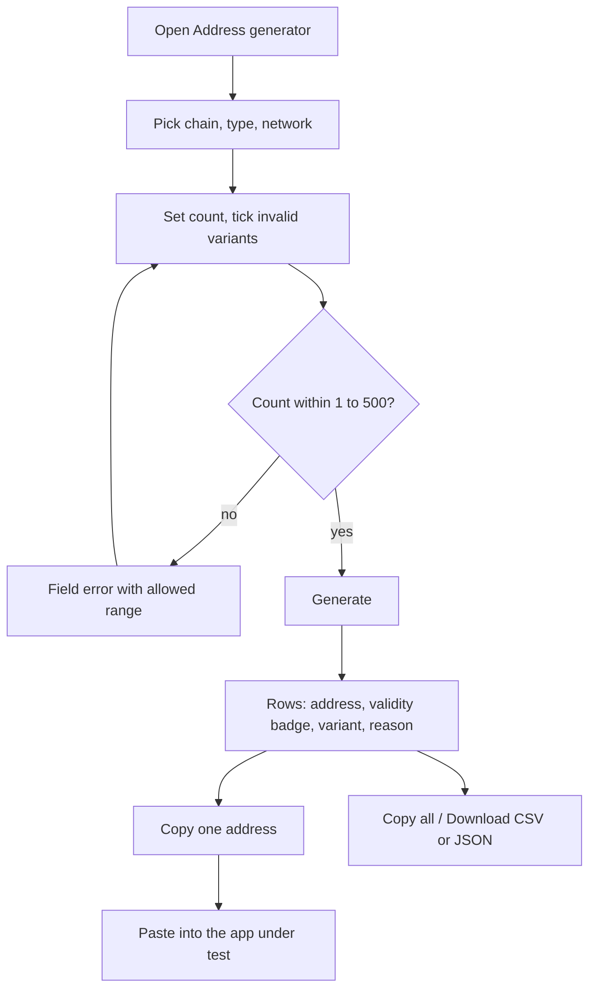
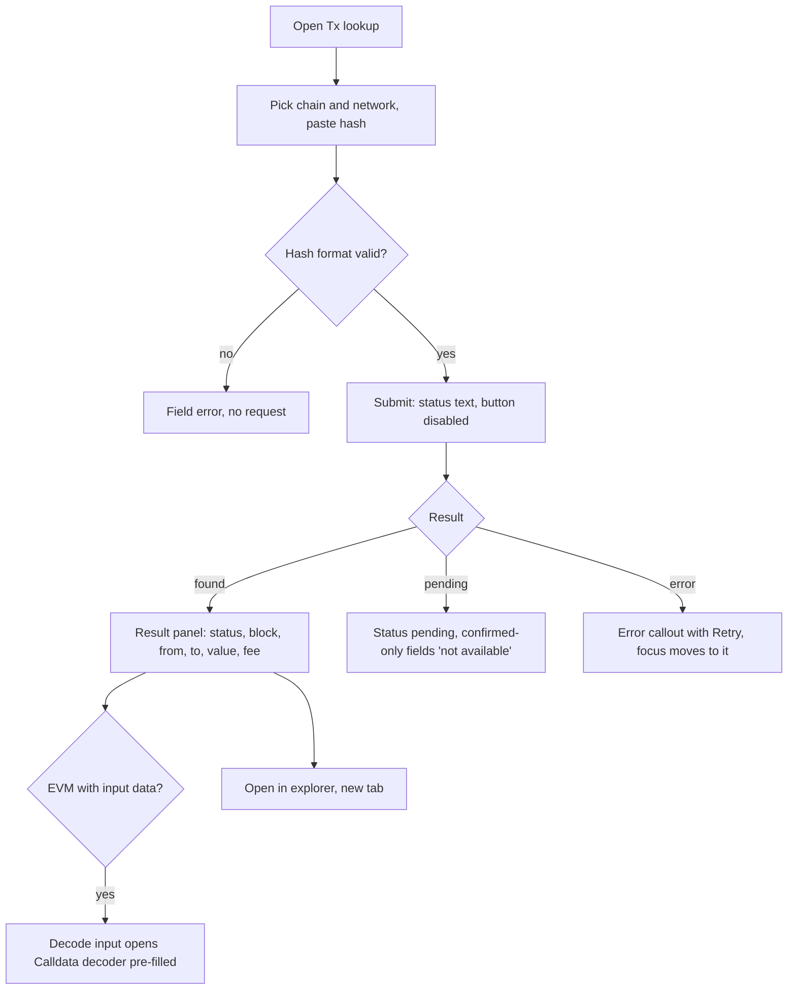
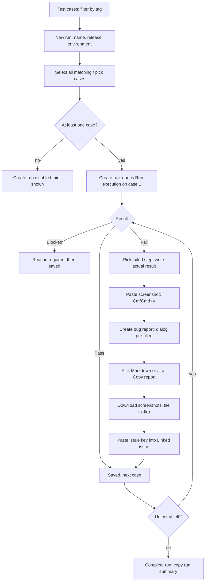

# QAnchor: Design Brief

* Status: APPROVED (owner; v0.3 on 2026-11-12, v0.4 polish layer on 2026-11-13); v0.5 Phase 2 on 2026-11-19)
* Version: 0.5
* Date: 2026-11-13
* Sources: `CLAUDE.md` (project context), `docs/prd.md` v0.3, `docs/decisions.md`
* Visual direction: **B "Anchor"**, chosen by the owner on 2026-11-12; refined as **A "Anchor, refined"** (polish layer) on 2026-11-13 after the project rules moved to "polished & optimized" (`docs/decisions.md`)

Changes in v0.4: references add Raycast and Arc; principle 2 allows subtle depth; new depth tokens and a `--duration-slow` / `--ease-spring` pair (section 2.3); a motion catalogue (section 2.4); button press and panel focus states (section 6); new owner decisions (section 12). Colours, type, spacing, layout, screens, flows, and copy are unchanged.

Conventions:

* Requirement IDs (`US-`, `FR-`, `NFR-`, `EC-`) refer to `docs/prd.md`.
* **[PROPOSAL]**: suggested by the designer, not yet approved.
* **[ASSUMPTION]**: assumed, to be confirmed.
* **[VERIFY]**: a fact that must be measured or checked before it is relied on.
* Phase 2 is designed in section 13. Phases 3 and 4 have no FR IDs yet; their screens are a [PROPOSAL] at outline level only.

## 0. Input

| Field | Value | Source |
| --- | --- | --- |
| Scope | Whole app, phases 1 to 4 | Owner, 2026-11-12 |
| Visual references | Linear, Vercel, Raycast, Arc | `CLAUDE.md`, owner 2026-11-13 |
| Disliked | Generic purple gradient / "AI look"; dark neon "web3" look | Owner, 2026-11-12 |
| Style | Clean utilitarian with a polish layer: tool-first and information-dense, subtle depth, purposeful motion | `CLAUDE.md`, owner 2026-11-13 |
| Theme | Light + dark, default follows the system | `CLAUDE.md`, FR-002 |
| Density | Compact, with a larger type and control scale than the first draft (owner, 2026-11-12) | `CLAUDE.md`, owner |
| Styling approach | Plain CSS + CSS variables as design tokens, no Tailwind | `CLAUDE.md` |

Deliberately avoided:

* Purple gradients, glow, hero sections (owner).
* Near-black backgrounds with neon accents (owner). The dark theme is a blue-tinted charcoal, and teal is used as a flat colour, never as a glow.
* [PROPOSAL] Backdrop blur and translucent panels: they lower text contrast (NFR-009) and cost GPU time.
* Continuous or decorative animation (NFR-006): no parallax, particles, looping loaders, or motion without a job.
* Fonts, scripts, or icons from third-party hosts (NFR-011).
* Status shown by colour alone (NFR-009).

## 1. Design principles

1. **One accent, used for action and focus only.** Teal marks the primary action, links, the active navigation entry, and the focus ring. Status colours (success, danger, warning) are reserved for meaning. Why: the user scans rows of valid, invalid, and valid-but-risky samples (FR-011 AC-5); if the accent also decorated things, those states would be harder to read.
2. **Hierarchy through type; depth and motion only explain.** Regions are separated by 1 px borders and type, never by nested cards. Depth is reserved for things you act on: a form panel and a primary button carry a 1 px top highlight and a hairline shadow, overlays carry a real shadow, and everything else stays flat. Motion is used only to show what changed (results arrived, value copied, tab moved), never to decorate. Why: compact density (`CLAUDE.md`) leaves no room for nested cards; the "polished" rules ask for craft, and subtle depth plus feedback motion adds it without slowing the scan of long result tables (FR-011 AC-5, NFR-002).
3. **Fixed sidebar, one wide content column, data in monospace.** Every tool page has the same skeleton: header, form, output. Every value the user may copy is monospace. Why: outputs are long strings (a Taproot address is 62 characters) that need width, and monospace keeps `0/O` and `1/l/I` distinguishable when the user compares addresses (US-001, US-002, US-012).

## 2. Design tokens

Tokens are CSS custom properties on `:root`. The theme is switched with `data-theme="light|dark"` on `<html>`; with no attribute the system preference applies (FR-002). Components use semantic tokens only, never raw hex values.

### 2.1 Colour

| Token | Role | Light | Dark |
| --- | --- | --- | --- |
| `--color-bg` | Page background | `#FFFFFF` | `#0B1017` |
| `--color-surface` | Sidebar, table header, form panel | `#F6F8FA` | `#131A22` |
| `--color-surface-raised` | Hover row, selected item, code block | `#EEF1F4` | `#1B242E` |
| `--color-border` | Dividers, panel outline (decorative) | `#D8DEE4` | `#2A3440` |
| `--color-border-strong` | Input and control outline | `#7D8590` | `#6B7785` |
| `--color-text` | Primary text | `#0F172A` | `#E6EDF3` |
| `--color-text-muted` | Secondary text, labels | `#475569` | `#A9B4C0` |
| `--color-text-subtle` | Hints, placeholders, metadata | `#5A6472` | `#8693A1` |
| `--color-accent` | Primary action, link, active nav, focus ring | `#0F766E` | `#2DD4BF` |
| `--color-accent-hover` | Hover/active of the above | `#115E59` | `#5EEAD4` |
| `--color-on-accent` | Text on an accent fill | `#FFFFFF` | `#042F2B` |
| `--color-accent-subtle` | Active nav background, selected tab | `#E6F4F1` | `#0F2E2B` |
| `--color-success` / `-bg` | Valid, pass, confirmed | `#1A7F37` / `#E8F5EC` | `#3FB950` / `#12261A` |
| `--color-danger` / `-bg` | Invalid, error, failed, destructive | `#CF222E` / `#FFEBE9` | `#F85149` / `#2D1416` |
| `--color-warning` / `-bg` | Valid-but-risky, pending, stale | `#8A5A00` / `#FFF4D6` | `#D29922` / `#2A2110` |
| `--color-info` / `-bg` | Neutral notice (fake-data note, storage banner) | `#0969DA` / `#DDF4FF` | `#58A6FF` / `#10243B` |

Reasons:

* Cool, slightly blue neutrals follow the Linear reference and keep long sessions comfortable (US-011).
* Teal gives the product an identity for the interviewer who sees it for a few minutes (PRD section 3), without the purple the owner rejected. It is also far enough from green, red, and amber that it cannot be mistaken for a status.
* The dark background is `#0B1017`, not pure black, to stay clear of the "neon on black" look.
* `--color-border-strong` exists because WCAG 1.4.11 requires 3:1 for control boundaries; the decorative border (1.36:1 light, 1.51:1 dark) is not used for inputs.

Contrast was computed with the WCAG 2.1 formula for every text/background pair in use. All pass AA; the lowest values are listed in section 9.

### 2.2 Typography

| Token | Value |
| --- | --- |
| `--font-sans` | `"Inter Variable", "Inter", "Inter Fallback", system-ui, -apple-system, "Segoe UI", Roboto, sans-serif` |
| `--font-mono` | `ui-monospace, SFMono-Regular, Menlo, Consolas, "Liberation Mono", monospace` |

* Inter is the only custom font: one variable file, self-hosted, Latin subset, `font-display: swap`, preloaded, with a size-adjusted system fallback so the swap does not shift layout. Why Inter: it is the typeface of the Linear reference and stays legible at small sizes, which compact tables need.
* Size impact: measured in T-005, the Latin variable file is **47.1 KB** (48,256 bytes, woff2). It does not count against the 80 KB JS budget (NFR-001) but it can affect LCP (NFR-002), which is measured on the live site in T-024; if LCP exceeds 1.5 s because of it, the fallback is the system stack (0 KB) with no other design change.
* `Inter Fallback` is Arial (or Liberation Sans) with `size-adjust: 109.38%`, `ascent-override: 88.57%`, `descent-override: 22.05%`, `line-gap-override: 0%`, computed from both font files so the swap to Inter does not shift text.
* Monospace uses system fonts (0 KB). Why: every OS ships a mono face that separates `0/O` and `1/l/I`, which is the property that matters for addresses and hashes.

Type scale (root 16 px, sizes in `rem`, so browser zoom and user font settings are respected):

| Token | Size / line height | Weight | Use |
| --- | --- | --- | --- |
| `--text-xs` | 13 / 18 px | 400, 500 | Badges, labels, table header, hints |
| `--text-sm` | 14 / 22 px | 400, 500 | Body, form controls, table cells (default) |
| `--text-md` | 15 / 22 px | 600 | Section heading |
| `--text-lg` | 18 / 26 px | 600 | Dialog title |
| `--text-xl` | 24 / 32 px | 600 | Page title |
| `--text-mono` | 13.5 / 22 px | 400 | Addresses, hashes, amounts, code |

Body is 14 px and 13 px is the floor; nothing is smaller. The first draft used 13 px body text, which the owner found too small to read comfortably when reviewing the prototypes, so the whole scale moved up one step. Numbers in tables use `font-variant-numeric: tabular-nums`.

### 2.3 Spacing, radius, shadow, motion

| Group | Tokens |
| --- | --- |
| Spacing (4 px base) | `--space-1` 4, `--space-2` 8, `--space-3` 12, `--space-4` 16, `--space-6` 24, `--space-8` 32, `--space-12` 48 |
| Control height | `--control-sm` 28 px, `--control-md` 36 px (default), table header 40 px, table row about 54 px for two-line cells; checkboxes 16 px; icons 18 px |
| Radius | `--radius-sm` 4 px (controls, badges), `--radius-md` 6 px (panels, dialogs), `--radius-full` 9999 px (status dot) |
| Shadow | `--shadow-overlay`: `0 4px 16px rgb(0 0 0 / 0.12)` light, `0 4px 16px rgb(0 0 0 / 0.5)` dark. Overlays (dialog, toast, small-screen menu). |
| Depth (v0.4) | `--shadow-panel`: light `inset 0 1px 0 rgb(255 255 255 / 0.9), 0 1px 2px rgb(15 23 42 / 0.05)`; dark `inset 0 1px 0 rgb(255 255 255 / 0.04), 0 1px 2px rgb(0 0 0 / 0.3)`. Form panels only. `--shadow-button`: `inset 0 1px 0 rgb(255 255 255 / 0.15), 0 1px 2px rgb(0 0 0 / 0.15)`. Primary button only. `--color-focus-glow`: light `rgb(15 118 110 / 0.08)`, dark `rgb(45 212 191 / 0.08)`, a 3 px halo around a form panel while a control inside it has focus. |
| Motion | `--duration-fast` 120 ms (hover, focus, press), `--duration-base` 180 ms (enter/leave, copy confirmation, tab indicator), `--duration-slow` 240 ms (menu and dialog open) (v0.4), `--ease-out` `cubic-bezier(0.2, 0, 0, 1)`, `--ease-spring` `cubic-bezier(0.34, 1.4, 0.64, 1)` (small overshoot, icons only) (v0.4), `--stagger-step` 28 ms (v0.4) |
| Layout | Sidebar 248 px, content max-width 1120 px centred in the remaining space, content padding 32 px top and 40 px sides |

Motion rules (NFR-006, NFR-003, `CLAUDE.md` 60 fps budget):

* Movement uses `opacity` and `transform` only, so it runs on the compositor. Colour changes on hover and focus (`background-color`, `color`, `border-color`) may transition at `--duration-fast` on single small elements; `box-shadow`, `width`, `height`, `top`, and `left` are never transitioned. The panel focus glow fades a pseudo-element's `opacity` instead of animating the shadow.
* Every animation runs once in response to an event and ends. Nothing animates while the app is idle. There is no spinner: in-flight work shows a text status, plus a determinate progress bar when progress is known (FR-080 AC-3).
* Under `prefers-reduced-motion: reduce`, all durations and `--stagger-step` are 0, so every state change is instant.
* 60 fps is verified, not assumed: a change that adds an animation reports the frame rate from a Chrome performance trace, measured on the heaviest case (500 generated addresses, 10,000 dummy rows).

### 2.4 Motion catalogue (v0.4)

Each interaction has one job. Anything not listed here does not animate.

| Interaction | Job | What moves | Duration / easing | Where |
| --- | --- | --- | --- | --- |
| Results enter | Show that new output arrived and where it starts | Each row: `opacity` 0 to 1, `translateY` 4 px to 0, delayed by `--stagger-step` × row index; only the first 12 rows are staggered, later rows appear with the 12th | base, ease-out | Data tables after Generate / Decode / Look up (S-02, S-03, S-05, S-06, S-09) |
| Copy confirmation | Confirm the copy at the pointer, not only in the toast | Copy icon fades and scales to 0.5 while a check fades and scales from 0.5 to 1; reverts after 1.4 s | base, ease-spring | Copy buttons (FR-004) |
| Tab indicator | Show which tab is active and where focus went | Accent underline: `translateX` and `scaleX` to the new tab | base, ease-out | Tabs (S-02) |
| Segmented control thumb | Same as tabs | Selected background: `translateX` | base, ease-out | Theme control, unit family (S-04, S-10) |
| Button press | Tactile acknowledgement | `scale(0.97)` while pressed | fast, ease-out | All buttons |
| Panel focus | Show which form is being edited | Focus glow pseudo-element `opacity` 0 to 1 | base, ease-out | Form panels |
| Menu open | Continuity from the Menu button | `opacity` 0 to 1, `translateY` -4 px to 0 | slow, ease-out | Small-screen menu (S-00) |
| Dialog open / close | Continuity, focus moves into it | Dialog `opacity` and `scale` 0.98 to 1; backdrop `opacity` | slow open, base close, ease-out | Dialogs (S-08, S-10) |
| Toast enter / leave | Non-blocking confirmation | `opacity`, `translateY` 4 px | base, ease-out | Toast |
| Verdict change | Show that the verdict was recomputed | Verdict panel crossfade (`opacity`) | fast, ease-out | Validate tab (S-02) |
| Theme change | none | No transition: switching themes repaints the whole page, so it is instant | n/a | Theme control |

Why these and no more: each one answers "did my action work, and where is the result?", which matters most when the user generates and copies dozens of samples in a row (J-1). Page-to-page transitions (View Transitions API) were offered and not chosen (owner, 2026-11-13).

## 3. Screen inventory

Route names are [PROPOSAL] and are confirmed in the tech plan.

### Phase 1

| ID | Screen | Route | Purpose | Requirements |
| --- | --- | --- | --- | --- |
| S-00 | App shell | all | Sidebar navigation, theme control, storage banner, build id in footer | FR-001, FR-002, EC-001, NFR-021 |
| S-01 | Toolkit index | `/` | List shipped tools with a one-line description | FR-001 AC-7 |
| S-02 | Address generator | `/address` | Generate valid and invalid addresses; validate a pasted address (two tabs) | FR-010, FR-011, FR-012, FR-014 |
| S-03 | Amount edge cases | `/amounts` | Edge-case amounts from token parameters | FR-020, FR-021, FR-022 |
| S-04 | Unit converter | `/units` | Exact unit conversion | FR-030, FR-031, FR-032 |
| S-05 | Tx lookup | `/tx` | Look up a transaction | FR-040, FR-042, FR-043 |
| S-06 | Calldata decoder | `/calldata` | Decode EVM calldata | FR-050 to FR-053 |
| S-07 | Checklists | `/checklists`, `/checklists/<topic>` | Browse, filter, and export checklists | FR-060, FR-061 |
| S-08 | Testnet wallets | `/wallets` | Manage wallet entries, faucet links, balance | FR-070 to FR-073 |
| S-09 | Dummy data | `/dummy-data` | Configure, generate, preview, export | FR-080 to FR-084 |
| S-10 | Settings | `/settings` | Theme, endpoint overrides, export/import | FR-002, FR-003, FR-041 |
| S-11 | Not found | fallback | Not-found state with a link home | FR-001 AC-3, NFR-022 |
| S-12 | Components | `/components` | Reference page with every primitive from section 6 in its states; not in the navigation. Host for the component E2E, axe, and performance tests (owner, 2026-11-13) | NFR-008, NFR-009, NFR-006 |

Slice mapping: 1a = S-00, S-01, S-02, S-03, S-04, S-10 (theme and export/import), S-11. 1b = S-07, S-09. 1c = S-05, S-06, S-08, S-10 (endpoints).

### Phases 2 to 4 (all [PROPOSAL], outline only; Phase 2 is detailed in section 13)

| ID | Screen | Purpose | PRD source |
| --- | --- | --- | --- |
| P2-01 | Test cases | List with filter by tag and priority | Phase 2 outline |
| P2-02 | Test case editor | Title, preconditions, steps, expected result, tags, priority | Phase 2 outline |
| P2-03 | Test runs | List of runs with pass/fail/blocked counts | Phase 2 outline |
| P2-04 | Run execution | One case at a time: mark result, paste screenshot, notes | Phase 2 outline |
| P2-05 | Bug report | Jira-format report pre-filled from a failed step | Phase 2 outline |
| P2-06 | Session notes | Timeboxed exploratory session: charter, findings | Phase 2 outline |
| P2-07 | Release summary | Run results rolled up per release | Phase 2 outline |
| P3-01 | PRD generator | Stepper: input, requirements, PM questions, test cases, traceability | Phase 3 outline |
| P3-02 | AI settings | API key section inside S-10, with the storage warning | Phase 3 outline |
| P4-01 | Demo mode | Sample PRD with pre-generated results; a banner marks demo data | Phase 4 outline |

These reuse the Phase 1 shell, tokens, and components. They add two sidebar groups ("QA" and "Generate") and three components (stepper, screenshot thumbnail, result segmented control), which are designed when each phase gets its FR IDs.

## 4. User flows

### J-1: Negative-test an address field (US-001, US-002)

### J-2: Triage an address from a bug report (US-012)

1. Open Address generator, switch to the Validate tab.
2. Paste the address. The verdict appears as the user types; no request is made (FR-014 AC-6).
3. Read the result: valid with chain/type/network, several matches, or not valid with the named defect.
4. If whitespace or invisible characters were present, read both the defect and the verdict for the trimmed value (FR-014 AC-4).

### J-3: Collect boundary amounts (US-003)

1. Open Amount edge cases. Pick a preset (decimals are filled in) or type decimals.
2. Optionally enter balance, fee, minimum, maximum.
3. Generate. Rows show input string, category, and purpose. A note lists omitted cases (FR-020 AC-3).
4. Copy a single input string, or export all.

### J-4: Verify a transaction and its calldata (US-005, US-006)

### J-5: Generate and export dummy data (US-009)

1. Open Dummy data. Optionally pick a scenario preset; fields and options are set and stay editable (FR-084 AC-1).
2. Choose fields, row count, and optionally a seed.
3. Generate. A progress bar shows while the worker runs (FR-080 AC-3).
4. The preview shows the first 100 rows and the total. The seed used is displayed and copyable (FR-082 AC-2).
5. Pick CSV, JSON, or SQL. SQL asks for a table name and a quoting style (FR-083).
6. Download.

### J-6: Back up and restore (US-010)

1. Settings, Data section, Export: a JSON file downloads.
2. Import: choose a file. A dialog titled "Replace all data?" names the file and its export date and shows, per type, what is stored now against what the import leaves (wallets, endpoint overrides, faucet links, theme); a count that drops is shown in the danger colour. It warns that all existing data will be replaced, and Cancel has focus first (FR-003 AC-2, AC-3). Chosen over a dialog with the file's counts only after testing `prototype/settings.html` (owner, 2026-11-13).
3. Confirm: success message with counts. Invalid file: error naming the reason, nothing written (FR-003 AC-4).

### J-7: Interviewer's first visit (secondary user, PRD section 3)

1. Opens the live link and lands on the toolkit index.
2. Reads the one-line descriptions, opens a tool.
3. Every tool has working defaults, so one press on Generate gives a result with no setup.

### Later phases [PROPOSAL]

* J-8 (Phase 2): detailed in section 13.2, with J-10 to J-12.
* J-9 (Phase 3): paste or upload a PRD, edit the numbered requirements, review PM questions, generate test cases with source quotes, open the traceability matrix, start a run.

## 5. Layout per screen

### S-00 App shell

* **Sidebar** (248 px, fixed, `--color-surface`, right border): product mark and name at the top; navigation in groups, each entry with an 18 px icon; Settings and the theme control pinned to the bottom. Groups (approved): "Blockchain" (Address generator, Amount edge cases, Unit converter, Tx lookup, Calldata decoder, Testnet wallets), "Data" (Dummy data, Checklists). Only shipped tools are listed (FR-001 AC-1).
* **Main**: one column, max-width 1120 px, centred in the space next to the sidebar. Page header (title `--text-xl`, one-line description in muted text), then the page content.
* **Storage banner**: an info callout at the top of main when IndexedDB is unavailable (EC-001).
* **Footer**: build commit id in subtle text (NFR-021).
* **Live region**: one visually hidden `aria-live="polite"` region plus a toast for confirmations (FR-004 AC-1).
* Skip link "Skip to content" as the first focusable element [PROPOSAL] (supports NFR-008).

Why a sidebar instead of a top bar: eight tools plus Settings do not fit a top bar at compact size without a menu, and a fixed list lets the user switch tools with one click all day.

### Tool page skeleton (S-02 to S-06, S-09)

1. Page header.
2. **Form panel**: controls in a row that wraps, labels above controls, one primary button at the end.
3. **Output toolbar**: result count on the left; Copy all, format select, and Download on the right. Disabled until there is output (FR-012 AC-2, FR-083 AC-5).
4. **Output**: a data table or a result panel.

The primary action is always the single filled teal button in the form panel. Why this order: it matches how the tools are used (set parameters, run, take output), and identical placement on every tool means nothing has to be relearned.

### Screens

| Screen | Sections and hierarchy | Primary action | Components |
| --- | --- | --- | --- |
| S-01 Toolkit index | Title, one-line product statement, list of tools (name as a link + description), grouped like the sidebar | Open a tool | Link list |
| S-02 Address generator: Generate tab | Form panel in three sections: (1) chain, address type, network, count in a 4-column grid, each with its hint below; (2) variant checkboxes, "Invalid" in two columns and "Valid but risky" beside it; (3) footer with the row total on the left and Generate on the right. Output: "Results" heading with per-status count badges, toolbar on the right; table columns #, Address, Status, Details (variant name, reason below it in muted text), copy icon | Generate | Tabs, Select, Number input, Checkbox group, Button, Data table, Status badge, Copy button |
| S-02: Validate tab | One large mono input, verdict panel below (verdict line, matches list, defect, trimmed-value verdict) | none (live) | Tabs, Text input, Callout, Status badge |
| S-03 Amount edge cases | Form: preset, decimals, balance, fee, min, max. Note listing omitted cases. Output: table (input string, category, purpose, copy) | Generate | Select, Text input, Callout, Data table |
| S-04 Unit converter | One panel, max-width 820 px: unit family segmented control in the panel header; below it one row per unit (unit name with its factor underneath, input, copy icon), error under the edited input. Format rules as a note under the panel. Custom token: decimals field | none (live) | Segmented control, Text input, Copy button |
| S-05 Tx lookup | Form: chain, network, hash. Result panel as a definition list (label left, mono value right, copy per value); Bitcoin shows inputs and outputs tables. Actions row | Look up | Select, Text input, Button, Definition list, Status badge, Callout, Link |
| S-06 Calldata decoder | Form: calldata textarea, optional ABI or signature textarea. Output: function name + selector, arguments table (index, name, type, value) | Decode | Textarea, Button, Data table, Callout |
| S-07 Checklists | List: filter field, checklist rows (title, item count). Detail: title, Copy as Markdown, items under headings | Copy as Markdown | Text input, Link list, Button, Empty state |
| S-08 Testnet wallets | Toolbar with Add wallet. Table: label, chain, network, address, balance + fetch time, actions (refresh, edit, delete). Row detail: notes and faucet links. Add/edit in a dialog | Add wallet | Data table, Dialog, Field, Button, Status badge, Link |
| S-09 Dummy data | Form: preset, field checkboxes, row count, seed, options (phone format, NPWP format, identifier realism). Fake-data note. Output: seed used, preview table, export controls | Generate | Select, Checkbox group, Number input, Text input, Progress, Callout, Data table |
| S-10 Settings | Sections stacked: Appearance (theme), Endpoints (table per network: default, override, reset), Data (Export, Import) | none page-wide; each section has its own | Segmented control, Text input, Button, Dialog |
| S-11 Not found | Title, one sentence, link to the toolkit index | Back to toolkit | Empty state |

Unit converter fields are stacked rather than side by side because a 2^256 value has 78 digits (FR-030 AC-4) and needs the full column width. Below 640 px the five unit families do not fit a segmented control, so a select takes its place (T-013).

## 6. Component library

All components use native elements first (`<button>`, `<select>`, `<dialog>`, `
`, `<table>`), which gives keyboard and screen-reader behaviour for free and keeps JS small (NFR-001, NFR-008).

| Component | Variants | Notes |
| --- | --- | --- |
| Button | primary (accent fill), secondary (outline), ghost (text only), danger; sizes sm 28 px (`--control-sm`), md 36 px (`--control-md`, default) | One primary per view. Heights match the inputs beside them; the earlier 24/28 px values contradicted the control tokens (corrected in T-008a) |
| Copy button | icon-only with accessible name "Copy <thing>"; text variant "Copy all" | Confirms through the live region (FR-004 AC-1) |
| Text input / Textarea | sans, mono; with unit suffix | Mono for addresses, hashes, amounts, calldata |
| Number input | text input with `inputmode="numeric"` | No spinner arrows: counts and decimals are validated as text (FR-010 AC-3) |
| Select | native `<select>` with `appearance: none` and a themed chevron 10 px from the right edge | Keeps native keyboard and picker behaviour, zero JS; the custom chevron replaces the browser arrow, which sat flush against the border |
| Checkbox, Checkbox group | with group label (`<fieldset>` + `<legend>`) | Variants, fields |
| Segmented control | 2 to 5 options, built on radio inputs; below 640 px a five-option group is replaced by a select with the same state | Theme, unit family |
| Tabs | text tabs with accent underline | Generate / Validate |
| Field | label, optional hint, error message | Wraps every control; error linked with `aria-describedby` |
| Status badge | success, danger, warning, neutral | Always icon + text: Valid, Invalid, Risky, Pending, Failed |
| Data table | default, with row actions | Sticky header, mono cells for data, horizontal scroll inside its own container |
| Definition list | label/value rows with copy | Tx result |
| Callout | info, warning, danger | Icon + title + text, optional action (Retry) |
| Toast | neutral | Auto-dismiss after 4 s, never the only place a message appears |
| Dialog | default, destructive | Native `<dialog>`; focus trapped and returned to the trigger |
| Progress | determinate bar + text | Bulk generation |
| Empty state | default | One sentence + optional action |
| Nav item | default, active | Active: accent-subtle background, accent text, `aria-current="page"` |
| Disclosure | native `
` | Wallet row detail, long reasons |

Icons [PROPOSAL]: a small set of inline SVGs (copy, check, cross, warning, external link, chevron), `currentColor`, no icon library. Why: an icon package would spend the JS budget on a handful of glyphs.

### States

| State | Button (primary) | Input / Select / Textarea | Table row | Nav item |
| --- | --- | --- | --- | --- |
| Default | accent fill, on-accent text | `--color-bg`, border-strong | `--color-bg` | muted text |
| Hover | accent-hover fill | border `--color-text-muted` | surface-raised | surface-raised |
| Focus (keyboard) | 2 px accent ring, 2 px offset | 2 px accent ring, 2 px offset | ring on the focused control inside | 2 px accent ring |
| Active / pressed | accent-hover fill, `scale(0.97)` (v0.4) | n/a | n/a | accent-subtle + accent text (current page) |
| Disabled | surface-raised fill, subtle text, `disabled` attribute | surface background, subtle text | n/a | n/a |
| Loading | label changes to the action in progress ("Looking up…"), `aria-busy`, disabled | n/a | n/a | n/a |
| Error | n/a | danger border + error text with icon below | n/a | n/a |

The focus ring uses `:focus-visible`, so it shows for keyboard users and not on mouse click.

Form panel (v0.4): default `--color-surface` with `--shadow-panel`; while any control inside has focus (`:focus-within`), the 3 px `--color-focus-glow` halo fades in. The control's own focus ring is unchanged, so the halo is extra context, never the only focus indicator (NFR-008).

## 7. Screen states and copy

"Offline" only applies to screens that call the network (S-05, S-08 balance); every other tool runs locally once its page has loaded. There is no service worker in Phase 1, so reloading while offline shows the browser's own error page.

| Screen | Empty | Loading | Error | Success |
| --- | --- | --- | --- | --- |
| S-02 Generate | "Pick a chain and a count, then generate. Add invalid variants for negative tests." Export disabled. | Button "Generating…" (only noticeable at 500) | Field: "Enter a whole number from 1 to 500." | Table + toolbar "12 addresses". Toast "Copied". |
| S-02 Validate | Nothing shown (FR-014 AC-5) | none (instant) | "Not valid for any supported chain." + defect, e.g. "Checksum does not match. Closest match: Bitcoin P2WPKH." | A "Valid" badge with "Bitcoin · P2TR · mainnet" (the badge says Valid or Risky in words, so the headline names the format only; T-022), or "Matches 2 formats. The format alone cannot tell them apart." |
| S-03 | "Enter the token's decimals to generate edge-case amounts." | Button "Generating…" | Field: "Decimals must be a whole number from 0 to 36." / "Balance has more than 6 decimal places." | Table + note "4 cases omitted: no minimum or maximum set." |
| S-04 | Fields empty, no message | none | "wei has no decimal places." / "Use . as the decimal separator and no thousands separators." | Other fields update |
| S-05 | "Paste a transaction hash to look it up. Nothing is requested until you submit." | Button "Looking up…", status text "Asking <host>…" | See below | Result panel |
| S-06 | "Paste calldata to decode it. Add an ABI or a signature for functions outside the built-in list." | none (instant) | "Calldata must be hex with an even number of digits." / "Selector mismatch: calldata 0xa9059cbb, ABI 0x095ea7b3." | Function + arguments table |
| S-07 | Filter with no match: "No checklist or item contains "<text>"." | none (static content) | none | "Copied as Markdown" |
| S-08 | "No wallets yet. Add a testnet address to keep it at hand." + Add wallet | Page: "Loading wallets…" until IndexedDB is read (FR-003 AC-5). Balance: "Refreshing…" | "This is a mainnet address. Only testnet Bitcoin addresses can be saved." Balance errors as S-05; old value kept and tagged "stale" | Row added; balance + "fetched 14:02" |
| S-09 | "Choose fields and a row count, then generate." Export disabled. | Progress bar + "Generating 10,000 rows…" | "Enter a whole number from 1 to 10,000." / "Select at least one field." / "This preset needs at least 2 rows." | "Showing the first 100 of 10,000 rows." + "Seed: 8f3a…" |
| S-10 | Endpoints show defaults | "Reading file…" on import; "Checking storage…" until IndexedDB is open | Red alert, focused: "Import failed. Nothing was changed." + "<file name>: <reason>", e.g. "Unknown schema version 3. This backup comes from a newer version of QAnchor." or "Wallet 2 of 2 ("Withdraw tests") has no address." Storage unavailable: Export and Import disabled with "Export and import need storage, which is unavailable in this tab." | "Import complete" + "Imported 3 wallets, 1 endpoint override, 0 faucet links, and the theme setting." Export: toast "Exported qanchor-backup-<date>.json". Cancel: toast "Import cancelled. Nothing was changed." |
| S-11 | "Page not found. This address does not match any tool." + "Back to toolkit" | none | none | none |

Tx lookup errors (FR-042). Each is a danger callout with Retry; focus moves to it (FR-042 AC-6):

| Case | Copy |
| --- | --- |
| Not found | "Transaction not found on <network>. Check that the selected network is the one the transaction was sent on." |
| Not found, Solana mainnet on the default endpoint | The not-found copy, plus: "The default Solana endpoint keeps only the last few days of transactions. For an older one, set an endpoint with full history in Settings." (T-035) |
| Rate limited | "<host> is rate-limiting requests. Try again later or set your own endpoint in Settings." |
| Connection (offline, DNS, CORS) | "Could not reach <host>. The request did not complete, so this says nothing about whether the transaction exists." |
| Timeout | "No response from <host> within 10 seconds." |
| Unexpected response | "<host> returned a response QAnchor could not read." |
| Network mismatch | "This endpoint serves chain ID 137, but <network> is chain ID 1." |

Shared copy:

* Fake-data note (FR-081 AC-8): "Generated data is fake and for testing only."
* Storage banner (EC-001): "Storage is unavailable in this browser session. Tools still work, but nothing will be saved."
* Notes hint (FR-071 AC-1): "Do not paste private keys or mnemonics here. Notes are stored and exported as typed."
* Clipboard failure (FR-004 AC-3): a dialog titled "Could not copy" with "Select the value and copy it manually." and the value in a read-only field that is focused and fully selected, so Ctrl/Cmd+C copies it. One dialog in the shell serves every Copy and Copy all (T-009).
* Import confirmation (FR-003 AC-3): "Importing replaces all existing data. This cannot be undone."

Copy rules: sentence case, no exclamation marks, say what happened and what to do next, never blame the user.

## 8. Layout adaptation (web)

Desktop-first; small screens must not break but are not optimized (PRD non-goals).

| Breakpoint | Layout |
| --- | --- |
| Desktop, >= 1024 px | Fixed 248 px sidebar, content column up to 1120 px. Form fields in a 4-column grid. |
| Tablet, 640 to 1023 px | Sidebar becomes a top bar with the product name and a native `
` menu holding the navigation. Content uses the full width. |
| Mobile, < 640 px | Same top bar. Form controls stack one per row. Tables scroll horizontally inside their own container, so the page itself never scrolls sideways. The output toolbar wraps onto two lines. |

Other rules: the layout works at 200% browser zoom (it reflows to the tablet layout); long mono values wrap with `overflow-wrap: anywhere` inside definition lists and stay on one line inside tables.

## 9. Accessibility

Target: WCAG 2.1 AA (NFR-009), keyboard-only usable (NFR-008).

Contrast, computed with the WCAG 2.1 relative-luminance formula. Minimums: 4.5:1 normal text, 3:1 large text and UI components.

| Pair | Light | Dark |
| --- | --- | --- |
| Text on bg / surface / raised | 17.85 / 16.77 / 15.75 | 16.15 / 14.83 / 13.28 |
| Muted text on bg / surface / raised | 7.58 / 7.12 / 6.68 | 9.06 / 8.32 / 7.45 |
| Subtle text on bg / surface / raised | 6.00 / 5.64 / 5.29 | 6.09 / 5.59 / 5.01 |
| Accent on bg / surface / accent-subtle | 5.47 / 5.14 / 4.84 | 10.25 / 9.41 / 7.80 |
| On-accent text on accent / accent-hover | 5.47 / 7.58 | 7.80 / 9.81 |
| Success on bg / its tint | 5.08 / 4.52 | 7.51 / 6.27 |
| Danger on bg / its tint | 5.36 / 4.67 | 5.69 / 5.12 |
| Warning on bg / its tint | 5.93 / 5.41 | 7.56 / 6.29 |
| Info on bg / its tint | 5.19 / 4.56 | 7.55 / 6.22 |
| Control border (border-strong) on bg / surface | 3.73 / 3.50 | 4.18 / 3.84 |

The lowest text pair is success on its tint in light mode (4.52:1), which is close to the limit; status badges therefore never use a smaller size than `--text-xs` at weight 500. These numbers are for the token values; the automated a11y scan in E2E (NFR-009) re-checks the rendered pages.

Keyboard and focus:

* Focus order follows the visual order: skip link, sidebar, page header, form, output toolbar, output.
* Every action is a native button or link; nothing depends on hover.
* Tabs and segmented controls use arrow keys within the group and Tab to leave it.
* Dialogs are native modal dialogs: the page behind is inert, Escape closes them, and focus returns to the trigger. Tab cycles through the dialog and may pass through the browser's own UI, but never reaches the page (T-008b).
* After Generate, focus stays on the button and the result count is announced; after an error, focus moves to the first invalid field or to the error callout (FR-042 AC-6).
* Minimum pointer target is 24 x 24 px.

Screen readers:

* Landmarks: `nav` (sidebar), `main`, `footer`; one `h1` per page.
* Every control has a visible label. Icon-only buttons have an accessible name that includes the object ("Copy address 3").
* Field errors are linked with `aria-describedby` and set `aria-invalid`.
* Status badges are text, so validity is read out; the icon is decorative.
* Copy confirmations and result counts go through one polite live region; errors use `role="alert"`.
* Tables use `<th scope>` and a caption.
* Theme, language (`lang="en"`), and reduced motion follow the system by default.

## 10. Platform conventions (web)

* Every tool has its own URL; reload and deep links work (FR-001 AC-2). Back and forward behave normally.
* Navigation uses links, actions use buttons. External links (explorers, faucets) open in a new tab, carry `rel="noopener noreferrer"`, and show an external-link icon (FR-043, FR-072).
* Native form controls, native dialog, native scrollbars. No custom context menu, no overridden text selection, no hijacked browser shortcuts.
* No app-specific keyboard shortcuts in Phase 1. A command palette could come later [PROPOSAL].
* The theme is applied before first paint by a small inline script, which the CSP must allow by hash (FR-002 AC-1, NFR-017). [ASSUMPTION] to be confirmed in the tech plan.

## 11. Prototypes

Static HTML mockups, for looking at only. They contain sample data, generate nothing, and are not part of the app build.

* `prototype/address-generator.html`: app shell + Address generator with valid, invalid, and valid-but-risky rows.
* `prototype/unit-converter.html`: app shell + Unit converter with an error state.
* `prototype/settings.html` (T-011): Settings with export and import (J-6). A dashed "Prototype controls" panel switches the stored data, injects sample files (valid, newer schema, not JSON, truncated, broken record, not QAnchor), and toggles the dialog style, a full storage quota, and unavailable storage. Its import is a simplified stand-in for the real guards. Outcome: dialog B (stored now against after import) was chosen; a "Stored now" line on the page was not.
* `prototype/directions.html` (v0.4): the three polish-round directions side by side, live. Direction A is the one chosen; its panel demonstrates the motion catalogue (staggered results, copy confirmation, tab indicator, panel focus). It loads fonts from Google Fonts for the comparison only; the app self-hosts every font (NFR-011).

Each file is self-contained: the tokens and components from this document are in its own `<style>` block, so it opens correctly from disk or in a preview pane. The duplicated CSS is acceptable for throwaway mockups; the app gets one token file.

Both have a working Light / Dark / System control. A dashed "Prototype" switch in the top-right corner toggles between states (Results / Empty on the address generator, Valid input / Error on the unit converter); it exists only in the mockups. Inter is not bundled with the prototypes, so they show Inter only if it is installed on the machine and the system font otherwise.

## 12. Owner decisions

All eight items below were approved by the owner on 2026-11-12, as recommended.

1. **Body size**: approved at 13 px, then raised to 14 px by the owner the same day after reviewing the prototypes (section 2.2).
2. **Inter fallback rule**: if the measured font file pushes LCP on the live site above 1.5 s, switch to the system font stack.
3. **No spinner**: text status + determinate progress only (section 2.3).
4. **Sidebar groups** "Blockchain" and "Data", in that order (section 5).
5. **Route names** as in section 3; the tech plan may still adjust them if a technical reason appears.
6. **Skip link and inline SVG icons** (sections 5 and 6).
7. **Phase 2 to 4 screens** (section 3) are a direction only; detailed design waits for each phase's FR IDs.
8. **Checklist detail as its own route** (`/checklists/<topic>`).

### v0.4 decisions

All four items below were approved by the owner on 2026-11-13, as recommended.

9. **Stagger cap**: only the first 12 result rows are staggered (12 × 28 ms = 336 ms total); later rows appear with the 12th. Recommended, because 500 staggered rows would take 14 s and delay copying. Alternative: no cap.
10. **Where depth appears**: form panels and the primary button only; tables, sidebar, and page stay flat. Recommended, because depth on dense tables competes with status colours. Alternative: also on tables and the output toolbar.
11. **Theme change is instant**, no cross-fade. Recommended, because a full-page transition repaints every element and can drop frames on long tables. Alternative: 180 ms cross-fade.
12. **Where the polish layer is built**: tokens and motion as part of T-008 (UI primitives), which builds the components the catalogue applies to; the small-screen menu animation comes with the first tool (T-013), when the menu first renders. Recommended, because no new task and no rework of merged work is needed. Alternative: a separate task right after T-006.

No design decision is open.

---

## 13. Phase 2: test cases, runs, bug reports (v0.5)

* Status: APPROVED (owner, 2026-11-19), with every recommendation in 13.9. Sections 0 to 12 are unchanged.
* Requirements: `docs/prd.md` section 10 (approved 2026-11-19). This section designs every Phase 2 screen at the same level as Phase 1 and replaces the outline rows P2-01 to P2-07 in section 3.
* Everything here reuses the Phase 1 tokens, shell, and components. No new colour, font, or spacing token is added. New components are listed in 13.5.
* The owner's decisions on this section are in 13.9.

### 13.1 Screens and routes

Record pages use query-string IDs on prerendered routes (FR-090 AC-2, ADR-011). Route names may still change in the tech plan for a technical reason (decision 5 in section 12).

| ID | Screen | Route | Slice | Requirements |
| --- | --- | --- | --- | --- |
| P2-01 | Test cases | `/cases` | 2a | FR-101, FR-102 |
| P2-02 | Test case editor | `/cases/new`, `/cases/edit?id=<id>` | 2a | FR-100, FR-102, FR-151 (2c) |
| P2-03 | Test runs | `/runs` | 2a | FR-113 |
| P2-03a | New run | `/runs/new` | 2a | FR-110 |
| P2-04 | Run execution | `/runs/view?id=<id>` | 2a; screenshots 2b | FR-111, FR-112, FR-113, FR-123 |
| P2-05 | Bug report | dialog on P2-04 and P2-06 | 2b | FR-120 to FR-122, FR-131 AC-3 |
| P2-06 | Sessions | `/sessions`, `/sessions/view?id=<id>` | 2c | FR-130 to FR-132 |
| P2-07 | Releases | `/releases`, `/releases/view?name=<release>` | 2c | FR-140, FR-141 |
| S-07 (added) | Checklist detail: Create test cases | dialog on `/checklists/<slug>` | 2c | FR-150 |
| S-10 (added) | Settings: Storage section | `/settings` | 2b | FR-092 |

Sidebar: a third group **"QA"** after "Blockchain" and "Data" (FR-090 AC-1), with Test cases, Test runs, and from slice 2c Sessions and Releases. New 16 px inline icons in the existing style: `cases` (list with ticks), `run` (play triangle), `session` (stopwatch), `release` (flag), `image`, `bug`, `arrow-up`, `arrow-down`, `trash`. Each is a few path commands, well under 1 KB together.

The empty `/runs/view` or `/cases/edit` without an `id` redirects to its list (EC-028). An unknown ID shows a record not-found state inside the page (FR-090 AC-3), not S-11.

### 13.2 User flows

#### J-8: Run test cases and file a bug (US-014 to US-016)

#### J-10: Exploratory session (US-017)

1. Sessions, Start session: charter, timebox (60 min default), release, environment.
2. The session page shows the charter and "0 min elapsed · 60 min left". Focus is in the finding field.
3. Type a finding, pick its type (Note by default), optionally paste a screenshot, press Ctrl/Cmd+Enter or Add finding. Focus returns to the field (FR-131 AC-4).
4. At 60 minutes a callout says the timebox is reached; the session keeps running (FR-130 AC-4).
5. End session. Copy the session as Markdown, or open a Bug finding's bug report.

#### J-11: Release report (US-018)

1. Releases lists every release used on runs and sessions, plus "No release".
2. Open one: totals, pass rate, runs, latest result per case (open failures first), sessions.
3. Copy summary as Markdown and paste it into the release ticket or chat.

#### J-12: Checklist to run (US-019)

1. Checklists, open Deposit, Create test cases. All items are ticked; untick a few; Create.
2. Message "Created 24 test cases." links to Test cases filtered by `deposit`.
3. New run, Select all matching, Create run (J-8).

### 13.3 Layout per screen

**P2-01 Test cases.** Page header with New test case (primary) on the right. Filter bar in a form panel: text filter, Tags (a `
` dropdown with checkboxes, "2 tags" when closed), Priority (checkbox group inline). Output toolbar: "124 test cases" (or "12 of 124 match"), New run with these (secondary; opens P2-03a with the same filter). Table: Key (mono), Title (link to editor), Priority badge, Tags (neutral chips, at most 3 then "+2"), Steps, Updated (relative date with the full date in `<time>`). Row actions: Duplicate, Delete. The filter is in the URL query (FR-101 AC-2).

**P2-02 Test case editor.** Page header: "TC-12" in mono above the title "Edit test case" (or "New test case"); Duplicate and Delete as ghost buttons on the right (edit only). One form panel, max-width 820 px like S-04, sections top to bottom:

1. Title (full width).
2. Priority (select) and Tags (text input with chips; existing tags offered through a native `<datalist>`; Enter or comma adds a chip; Backspace in an empty field removes the last chip).
3. Preconditions (textarea, 3 rows, grows with content).
4. Steps: an ordered list. Each step is a row: number, Action textarea, Expected result textarea (optional, labelled so), and three icon buttons (Move up, Move down, Remove step) with names that include the number ("Move step 3 up"). Add step (secondary) under the list. In 2c, each step row also has Insert test data (FR-151).
5. Expected result (case level; hint: "Required if no step has an expected result.").

A footer bar sticks to the bottom of the viewport while the form is longer than the screen: "Unsaved changes" status text on the left, Cancel and Save on the right. Leaving with unsaved changes opens the native `beforeunload` prompt for reloads and a QAnchor dialog for in-app links (FR-100 AC-7).

**P2-03 Test runs.** Header with New run (primary). Table: Name (link), Release, Status badge (In progress: neutral; Completed: success), Progress (13.5 results bar plus "18 / 40"), Created. Row action: Delete.

**P2-03a New run.** Form panel: Name (default "Run <YYYY-MM-DD>", editable), Release (input with `<datalist>` of known releases), Environment (textarea, 2 rows, hint "Build, device, OS, browser, network."). Below it the case picker: the P2-01 filter bar, then a table with a checkbox column, a header checkbox for "Select all matching (n)", and the selected count in the toolbar ("40 selected"). Create run (primary) sits in a footer bar with the count, disabled with the hint "Select at least one test case." when nothing is selected. Selected cases keep their order by key.

**P2-04 Run execution.** The main screen of Phase 2.

* Header: run name, then a meta line (release, environment on one line, truncated with the full text in a disclosure), the results bar with counts in words ("18 passed, 3 failed, 2 blocked, 17 untested"), and actions: Copy summary, Complete run (secondary). A completed run shows a "Completed" badge and Reopen; every control below is read-only.
* Body: two panes inside the 1120 px column. **Case list** on the left (280 px, own scroll): one row per case with key, title (one line, truncated), and a status badge; the current case has the accent-subtle background and `aria-current="true"`; a type-filter select above it (All, Untested, Failed, Blocked, Passed). **Case pane** on the right:
  1. Case header: key, title, priority badge, "Case 19 of 40", Previous and Next buttons.
  2. Preconditions (if any), then the steps as a numbered table: #, Action, Expected result. Case-level expected result below it.
  3. **Result panel** (form panel with focus glow): the result control (13.5), then fields by status: Fail shows Failed step (select: "Step 1: <first words>" … "Not step-specific") and Actual result (required); Blocked shows Reason (required); every status shows Notes. Fail and Blocked also show Linked issue (FR-123). From 2b: the screenshot area (13.5) and, for Fail, Create bug report (secondary).
  4. "Saved 14:02" status text in the result panel footer; there is no Save button for the status itself (FR-111 AC-2), while required text is saved with Save result (primary), which appears only when Fail or Blocked is chosen and the text is not yet saved.
* Below 1024 px the case list moves into a `
` disclosure above the case pane ("Case 19 of 40 · show all").
* The URL carries the current case (`&case=<key>`), so a reload returns to it.

**P2-05 Bug report (dialog).** A large native dialog (max-width 880 px, max-height 90vh, body scrolls). Title "Bug report: TC-12". Fields, all pre-filled and editable (FR-120): Summary, Priority (select), Labels, Environment, Preconditions, Steps to reproduce (one textarea, numbered lines), Expected result, Actual result, Notes. Then Attachments: thumbnails with their file names and a download icon each, plus Download all. Footer: format segmented control (Markdown | Jira), Preview (a disclosure showing the exact text that will be copied, mono, read-only), Close (ghost), Copy report (primary). Closing after an edit asks "Discard your edits to this report?" because the report is not stored (FR-120 AC-5).

**P2-06 Sessions.** List page: a Start session form panel at the top (Charter, Timebox segmented control 30 / 60 / 90 / Custom with a minutes field for Custom, Release, Environment, Start session primary) and the sessions table below (Charter, Release, Status badge Running / Paused / Ended, Time, Findings by type as "3 bugs · 2 questions"). Session page: header with the charter, meta line, and a clock line in tabular numbers, "23 min elapsed · 37 min left" (13.9 decision 2), with Pause / Resume and End session. Below it the finding composer (form panel): type segmented control (Bug, Question, Idea, Note), finding textarea, screenshot area, Add finding (primary, Ctrl/Cmd+Enter). Then the findings list, newest last, each with "at 12 min", a type badge, the text, thumbnails, and for Bug findings Create bug report. Copy session in the header.

**P2-07 Releases.** List: table of releases (Release, Runs, Sessions, Pass rate, Last activity), "No release" last. Release page: a stat row of five figures (Executed, Pass rate with "from 112 of 120 executed", Failed, Blocked, Untested), then three sections: Runs (table with the results bar per run), Latest result per case (table: key, title, status, actual result or reason, linked issue; failed and blocked first, then the rest collapsed in a disclosure "Show 96 passed"), Sessions (charter, time, findings counts). Copy summary (primary) in the header.

**S-10 Storage section (2b).** Under Data: "Storage" with a determinate bar ("38 MB of about 2 GB used", from the estimate), a status line with a badge ("Persistent" success, or "Not persistent" warning plus "The browser may delete this data when disk space runs low."), and Keep data persistent (secondary), hidden once persistent.

### 13.4 Keyboard

Phase 1 had no app shortcuts (section 10). Phase 2 adds them on P2-04 only (FR-111 AC-7):

| Key | Action |
| --- | --- |
| `P`, `F`, `B` | Set Pass, Fail, Blocked on the current case. `F` and `B` move focus to the first required field. |
| `J`, `K` | Next, previous case |
| `?` | Opens the shortcut list (a dialog) |

They work only when focus is not in a text field, select, or dialog, and never with a modifier, so browser and screen-reader shortcuts are untouched. A "Keyboard shortcuts" link in the header lists them. On P2-06, Ctrl/Cmd+Enter in the finding field adds the finding. Everywhere else, Tab order follows section 9.

### 13.5 New components

| Component | Variants | Notes |
| --- | --- | --- |
| Result control | Pass, Fail, Blocked; read-only | A segmented control (radio inputs) whose selected option takes the status colours: success, danger, warning tint with the status text colour and an icon (check, cross, warning). Untested is the state with nothing selected, shown as "Untested" text beside it. Arrow keys move within it as in section 9. |
| Results bar | default | A static stacked bar (pass, fail, blocked, untested segments, 6 px high, `--radius-full`), always paired with the counts in words, so colour is never the only carrier (NFR-009). It is not animated (width changes are not transitioned, section 2.3). `role="img"` with the counts as its name. |
| Status badge (extended) | + Pass, Fail, Blocked, Untested, Running, Paused, Ended, Completed | Same rules as Phase 1 badges. |
| Priority badge | Critical (danger), High (warning), Medium (neutral), Low (neutral, subtle text) | Text always shown. |
| Tag chip | neutral; removable | Removable chips have a 24 px remove button named "Remove tag <tag>". |
| Steps editor | edit, read-only table | See P2-02. |
| Screenshot area | empty, compressing, thumbnails, full, error | A dashed-border drop target that is also a button ("Add screenshot: paste, drop, or choose a file"). Paste works anywhere inside the result panel or finding composer when the clipboard holds an image, also with focus in a text field; a text-only paste behaves as usual (EC-029). While compressing: a placeholder tile with "Compressing…". Thumbnails are 96 × 64 px, `object-fit: cover`, each a button that opens the viewer, with a remove icon button. At the limit the target is replaced by "5 of 5 screenshots". |
| Image viewer | dialog | The image at up to 90vw × 85vh, file name and size below, Download, Close. Escape closes; focus returns to the thumbnail (FR-112 AC-3). |
| Sticky footer bar | default | Editor and New run: stays at the viewport bottom while the form is taller than the screen; `--color-surface` with a top border, no shadow. |

### 13.6 Motion additions

Same rules as section 2.4; reduced motion makes all of them instant.

| Interaction | Job | What moves | Duration / easing | Where |
| --- | --- | --- | --- | --- |
| Case switch | Show that the case pane changed | Case pane crossfade (`opacity`) | fast, ease-out | P2-04 |
| Result set | Confirm the choice at the control | Status icon in the selected option scales 0.5 to 1 | base, ease-spring | Result control |
| Thumbnail added | Show where the screenshot went | `opacity` 0 to 1, `scale` 0.96 to 1 | base, ease-out | Screenshot area |
| Finding added | Show the new entry | Same as "Results enter", one row | base, ease-out | P2-06 |
| Timebox reached | Draw attention once | Callout `opacity`, `translateY` 4 px | base, ease-out | P2-06 |

The results bar, the counts, and the clock never animate.

### 13.7 Screen states and copy

| Screen | Empty | Loading | Error | Success |
| --- | --- | --- | --- | --- |
| P2-01 | "No test cases yet. Write one, or create them from a checklist." + New test case, and from 2c a link to Checklists. Filter with no match: "No test case matches these filters." + Clear filters | "Loading test cases…" | Storage unavailable: "Test cases need storage, which is unavailable in this tab." | "Deleted TC-12." toast; "Duplicated as TC-31." |
| P2-02 | n/a | "Loading TC-12…" | "Enter a title." / "Add an expected result to a step or to the case." / "A tag can be up to 32 characters: letters, digits, - _ ." / "Up to 50 steps." Record missing: "Test case not found. It may have been deleted, or it was created in another browser." + Back to test cases | Toast "Saved TC-12." |
| P2-03 | "No runs yet. Start one from your test cases." + New run (disabled with "Write a test case first." when there is none) | "Loading runs…" | as P2-01 | Toast "Deleted run "<name>"." |
| P2-03a | No cases: "There are no test cases to run yet." + New test case | "Loading test cases…" | "Select at least one test case." / "Up to 500 test cases per run." | Navigates to P2-04 |
| P2-04 | n/a | "Loading run…" | "Write the actual result to save a failure." / "Write the reason to save a block." Record missing: "Run not found…" as P2-02 | "Saved 14:02"; complete: "Run completed: 36 passed, 3 failed, 1 blocked." |
| P2-04 complete dialog | Title "Complete this run?" Body "4 test cases are still untested. They will stay untested in the run and the release summary." Buttons: Cancel (focused), Complete run | | | |
| P2-05 | n/a | "Preparing screenshots…" while thumbnails decode | Clipboard failure: section 7 shared dialog | Toast "Copied as Jira markup" / "Copied as Markdown" |
| Screenshot area | "Paste, drop, or choose an image." | "Compressing…" | "The clipboard has no image." / "<file> is not an image." / "This browser cannot open <file> (HEIC)." / "Images up to 25 MB and 50 megapixels." / "Not enough storage to save this screenshot. 1.9 GB of 2 GB used." + link to Settings | Thumbnail appears; live region "Screenshot added, 2 of 5." |
| P2-06 list | "No sessions yet. Start one with a charter and a timebox." | "Loading sessions…" | "Enter a charter." / "Timebox from 5 to 480 minutes." | Navigates to the session |
| P2-06 session | Findings: "No findings yet. Note what you observe as you go." | "Loading session…" | Record missing as P2-02 | Timebox: info callout "Timebox reached. The session keeps running until you end it." |
| P2-07 | "No releases yet. Add a release to a run or a session to see it here." | "Loading releases…" | Unknown release: "No run or session uses the release "<name>"." | Toast "Copied release summary" |
| S-07 create dialog | n/a | "Creating 24 test cases…" | Duplicate warning (warning callout): "6 of these items already exist as test cases with the tag deposit." + Skip existing (default) / Create anyway | "Created 18 test cases." + link "View them" |
| S-10 storage | n/a | "Checking storage…" | Refused: "The browser did not make storage persistent." plus one line on how that browser decides, written after the PRD 10.7 check of `navigator.storage.persist()` [VERIFY] | Badge "Persistent" |

Destructive dialogs (danger variant, Cancel focused first): "Delete TC-12?" with "It is in 3 runs. Those runs keep their own copy." / "Delete run "<name>"?" with "Its 40 results and 6 screenshots are deleted too. This cannot be undone." / "Remove this screenshot?" / "Discard your edits to this report?".

### 13.8 Accessibility and layout notes

* P2-04's two panes are a `nav` (case list, labelled "Cases in this run") and a `section` labelled by the case title. Moving to another case moves focus to the case heading and announces "Case 19 of 40: <title>".
* A status change is announced through the live region: "TC-12 marked Failed. 18 passed, 3 failed, 2 blocked, 17 untested."
* Step tables in P2-04 have a caption ("Steps for TC-12") and `<th scope="col">`.
* Thumbnails have alt text "Screenshot 2 of TC-12" (or of the finding), as the app cannot describe the image.
* Text areas grow with content up to 12 rows, then scroll; a textarea never resizes the page while typing a single line.
* Below 640 px, P2-04 stacks (case list disclosure, case pane), the editor's step buttons wrap under the textareas, and the bug report dialog is full-screen.

### 13.9 Owner decisions

All four items below were approved by the owner on 2026-11-19, as recommended.

1. **Prototype before slice 2a code.** Recommended: a static `prototype/run-execution.html` (P2-04 with the result panel, screenshot area, and the bug report dialog, light and dark), like the Phase 1 prototypes, reviewed before the tech plan is final. Why: it is the screen used most, and its two-pane layout is the one new layout in the app. Alternative: go straight to implementation and review on the PR preview.
2. **Session clock resolution.** Recommended: minutes ("23 min elapsed · 37 min left"), updated once a minute while the page is visible. Why: timeboxes are planned in minutes, and a per-second timer keeps the page busy for the whole session (idle CPU rule, NFR-003). Alternative: `mm:ss`, updated every second while visible.
3. **Bug report as a dialog.** Recommended: a large dialog on the run (P2-05). Why: the tester returns to the same case right after copying, and the report is not stored, so a page of its own adds a route without adding state. Alternative: its own route `/runs/report?id=&case=`.
4. **Order of cases in a new run.** FR-110 AC-2 says "in the order of the selection". Recommended reading: the order of the case list (by key), whatever order they were ticked in. Why: predictable, and it matches how the cases are listed everywhere else. Alternative: the order in which they were ticked.
